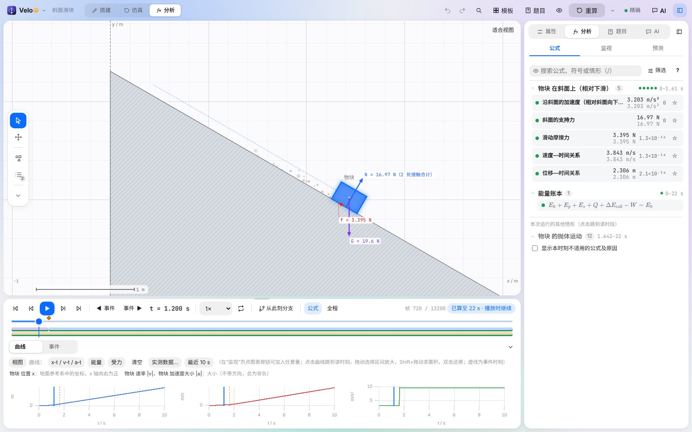
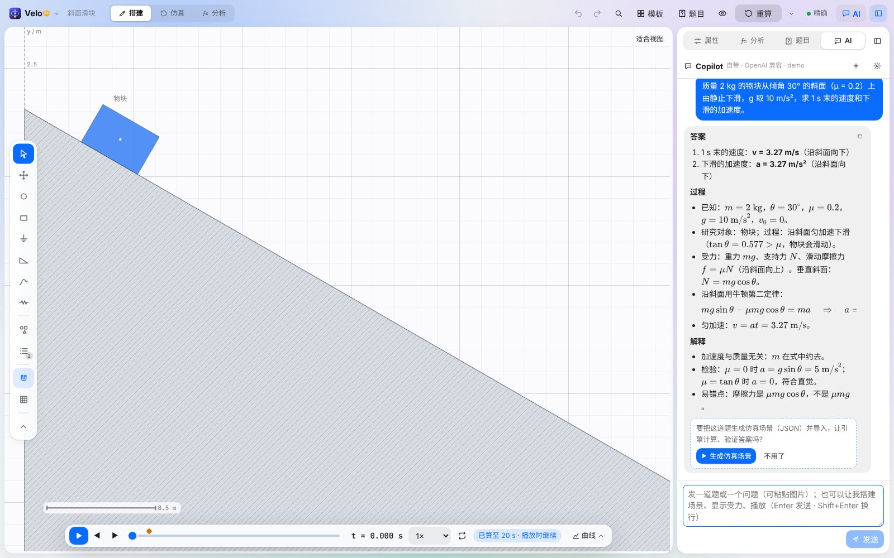
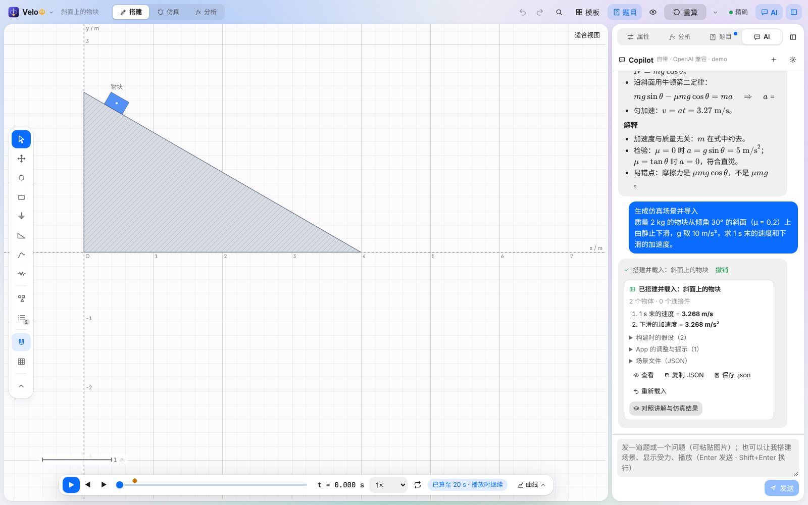
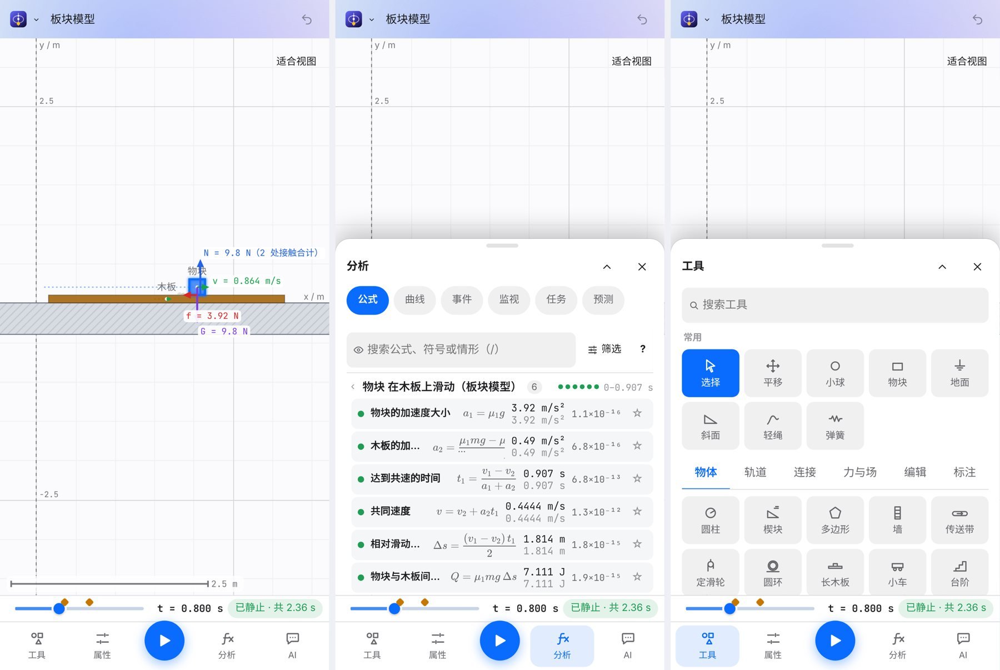
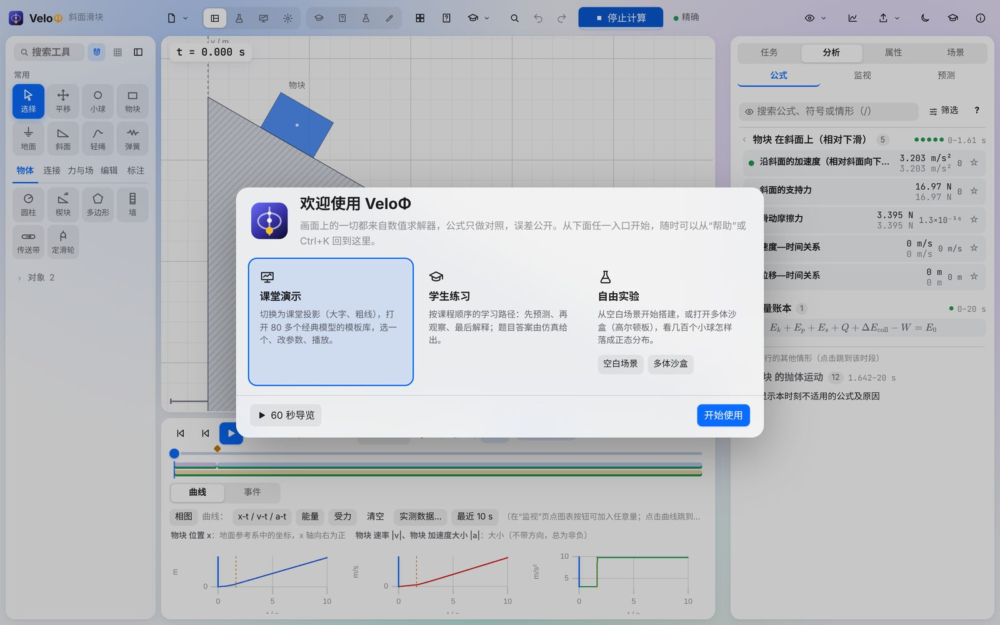
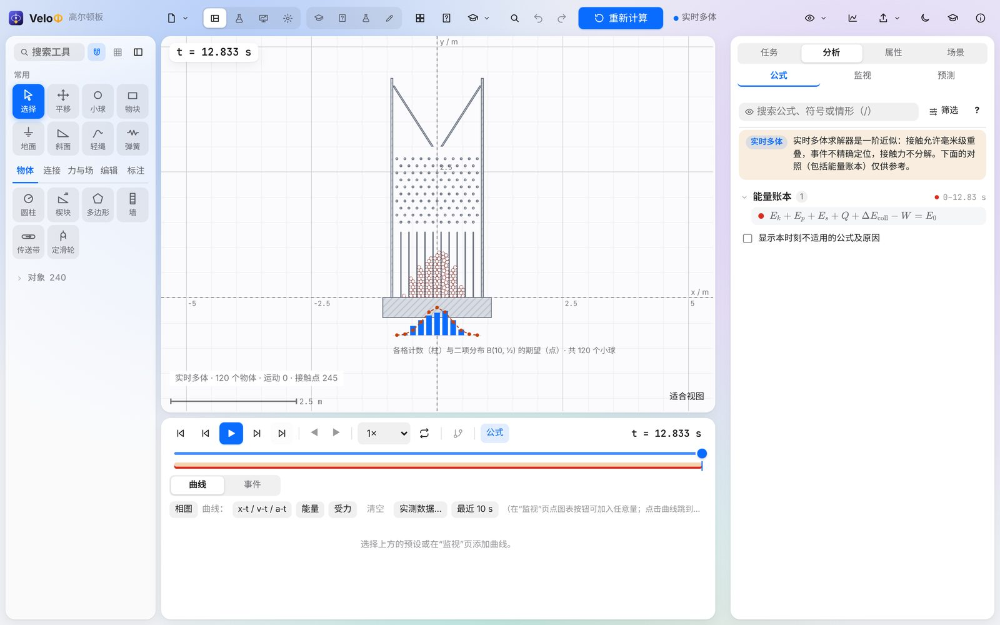
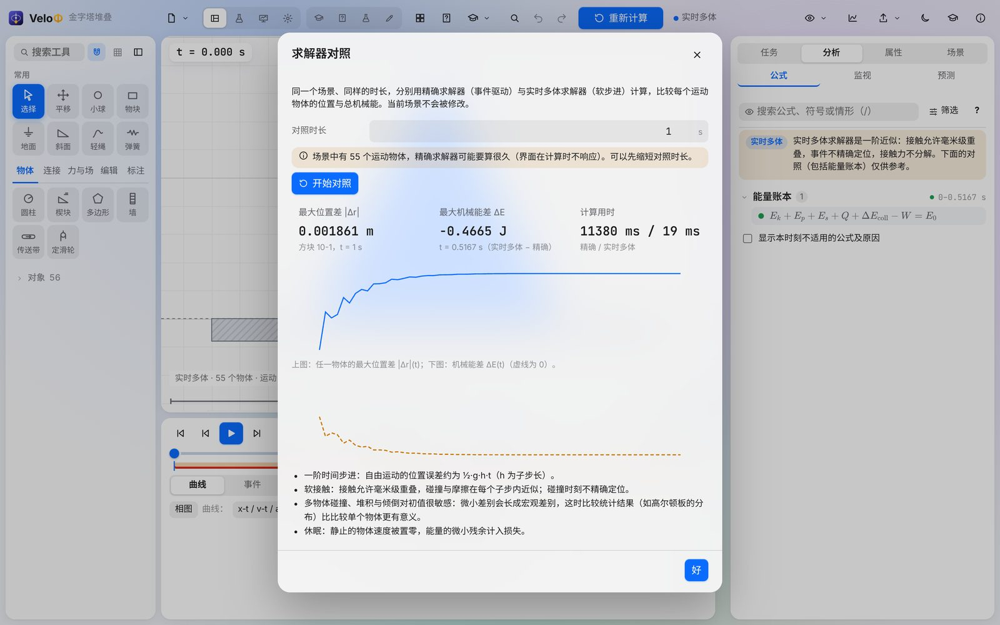
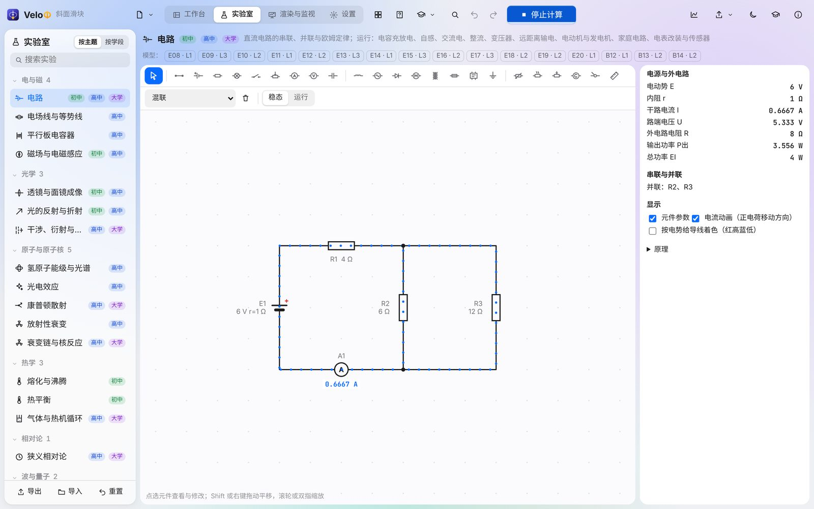

# VeloΦ (VeloPhi) 26.65

[English](README.md) · [简体中文](README.zh-CN.md) · **Deutsch**

VeloΦ ist eine Physik- und Chemiesimulation und Lernumgebung für Schülerinnen und Schüler, Studierende, Lehrkräfte und alle, die Physik verstehen wollen. Sie bauen eine Szene — Klötze, Kugeln, schiefe Ebenen, Seile, Federn, Ladungen, Schaltungen, Linsen —, starten sie und lesen jede Größe zu jedem Zeitpunkt ab. Erkannte Lehrbuchsituationen zeigen ihre Formeln mit Gültigkeitsbedingungen und eingesetzten Werten **neben** dem simulierten Ergebnis, die Abweichung offen sichtbar.

> Alles auf dem Bildschirm stammt aus dem numerischen Löser; Formeln werden nur verglichen, Fehler offen gezeigt. Das meinen wir mit *physikalisch nachprüfbar richtig*.



- **Repository:** <https://github.com/Stevenzhang543/VeloPhi>
- **Downloads:** <https://github.com/Stevenzhang543/VeloPhi/releases> (Windows portabel / Installer, Linux deb / rpm / AppImage, Android-APK, Web-Version)
- **Sprachen:** 简体中文 · English · Deutsch (Einstellungen › Allgemein › Sprache; standardmäßig wie das System)

## Merkmale

- **Ein Chemie-Labortisch, der rechnet (neu in 26.64).** Reagenzien, Geräte, Wärme, Gase und Elektroden; jeder Messwert — pH, Temperatur, Farbe, Masse eines Niederschlags, Gasvolumen, Zellspannung — kommt aus dem Chemiekern: Gleichgewichte auf einem Netzwerk aus den PHREEQC-Datenbanken, deklarierte Reaktionen mit Geschwindigkeitsgesetzen, eine Energiebilanz. Dazu ein Periodensystem, 553 Stoffseiten mit 3D-Strukturen, eine Nuklidkarte und eine Reaktorwerkstatt.
- **Ein exakter Löser für den Unterricht.** Ereignisgesteuerte Integration (Dormand–Prince 5(4) mit Fehlerkontrolle oder symplektisches Gauß–Legendre); Kontakt-, Reibungs-, Stoß- und Seilzustände wechseln an Ereignissen, die auf etwa 10⁻¹² s bestimmt werden; Zwangskräfte werden exakt aus den Beschleunigungsgleichungen gelöst; die Energiebilanz schließt auf 10⁻⁸.
- **Ein Arbeitsbereich, in dem die Zeichenfläche zählt.** Eine Leiste über der Zeichenfläche (Datei, Rückgängig, Vorlagen, Ablauf — und am Ende *Objekt · Analyse · KI*), eine schwebende Werkzeugleiste, eine schwebende Zeitleiste und ein Inspektor, der der Auswahl folgt; auf dem Smartphone eine untere Tableiste mit Bereichen, die von unten aufgehen.
- **Copilot und KI-Aufgabenlesen.** Eine Aufgabe als Text oder Foto senden: Copilot antwortet mit Antwort, Lösungsweg und Erklärung und erzeugt auf Wunsch die Simulationsszene (eine JSON-Szenendatei), mit der die Engine die Antworten berechnet und prüft; außerdem beantwortet er Fragen und bedient die App für Sie. Die Arbeitsteilung ist strikt: Die KI *liest* und *handelt*, jede Zahlenantwort berechnet der Rechenkern.
- **Ein Mehrkörper-Löser.** Stapel, Schüttgut, Dominosteine und Galtonbretter mit Hunderten von Körpern, berechnet mit einem Soft-Step-Löser, der nach den zu Box2D v3 und Rapier veröffentlichten Verfahren neu implementiert wurde — und ein **Löservergleich**, der zeigt, wie weit er vom exakten Löser entfernt ist.
- **Formeln, die geprüft und nicht behauptet werden.** 212 Modellfamilien (180 aus dem Fähigkeitsbauplan, 32 für den Lehrplan) mit Bedingungen in vier Zuständen, unabhängigen Referenzen und schrittweisen Herleitungen; Formeln sind nach Lehrplanstufe gestuft (chinesischer Lehrplan oder IB).
- **Labor.** Gleich- und Wechselstromkreise, elektrische und magnetische Felder, Linsen und Strahlenoptik, Wellenoptik, Wellen und Schall, 1D-Quantenmechanik, Gase und Wärmekraftmaschinen, radioaktiver Zerfall und Kernreaktionen, spezielle Relativitätstheorie.
- **Werkzeuge für den Unterricht.** Vorhersagen mit Sicherheitsangabe, Aufgaben aus eingefügtem Text, Lernpakete, Lernaktivitäten, Kräftepläne, Papierstreifen, Aufgabensammlungen, Versuchsberichte und Unterrichtsmaterial als Export.
- **Reproduzierbar.** Deterministische Mathematik: dieselbe Szene ergibt denselben SHA-256-Fingerabdruck in der Desktop-App, im Browser und in Node; ausgelagerte Bilder werden aus Prüfpunkten bitgenau neu berechnet.
- **Offen und offline.** Eine portable `.exe`, Linux-Pakete, eine APK oder eine statische Web-Version; Simulation und Unterrichtswerkzeuge brauchen kein Konto, keinen Server und keine Plug-ins. Die KI-Funktionen arbeiten mit einem eigenen API-Schlüssel (OpenAI-kompatibel oder Anthropic) oder nach der Anmeldung mit einem whitelists.top-Konto mit der offiziellen KI.

## Neu in 26.65

| Bereich | Änderung |
| --- | --- |
| Eine Leiste, ein Inspektor | Über jeder Zeichenfläche steht nur noch eine Leiste. Das Physiklabor kommt von vier Zeilen auf eine Leiste und eine Bauteilzeile; der Bereich Bewegung verzichtet auf die Voreinstellungen *Aufbauen / Simulation / Analyse* und wählt die Ansicht der Seitenleiste (*Objekt · Analyse · Aufgaben · KI*) am Ende seiner Leiste. Die Seitenleiste ist ein einziger Inspektor: das ausgewählte Objekt oder, ohne Auswahl, die ganze Szene. Lange Erläuterungen öffnen sich unter *Erklärung*. |
| Start | Jeder Start öffnet die Startseite (die Einführung von 26.64 konnte das unbemerkt ändern). Der Startbildschirm folgt dem hellen oder dunklen Systemdesign. |
| Text und Abstände | Echte Tiefstellungen (v<sub>y</sub>, U<sub>AB</sub>) statt Unterstrichen; chinesische Satzzeichen in voller Breite; die Schriften der Oberfläche auch auf der Zeichenfläche; nichts unter 12 px; Zeilenabstand je Sprache; Dezimalkomma und Silbentrennung statt Auslassungspunkten; Zahlenfelder zeigen in Ruhe sechs gültige Ziffern. |
| Ruhigeres Erscheinungsbild | Flaches Logo und App-Symbole, eine Behandlung je Fläche (eine Haarlinie oder ein Schatten), fünf Radien, keine dekorativen Skalenstriche oder Tastenkappen. |
| Ein Labortisch zum Anfassen | Ein Becherglas oder eine Reagenzflasche über ein anderes Gefäß ziehen, um zu gießen, mit laufender Mengenanzeige; beschriftete Flaschen mit Stopfen; freie Aufstellung mit Stativ, Klemme, Ring, Dreifuß und Wanne, die einrasten; Brenner, Heizplatte und Bäder als eigene Gegenstände; Tropfpipette, Spatel und Pinzette. Flammen, Rauch, Funken, Silberspiegel, flitzendes Natrium und entweichende farbige Gase werden aus den Ereignissen des Kerns gezeichnet; Fehler haben Folgen, die der Kern berechnet (Überlaufen, herausgedrückter Stopfen, Sprung durch plötzliches Abkühlen). Live-Kurven von Temperatur, pH und Gasvolumen. |
| Physik | Formelkarten korrigiert (Brett auf glattem Boden, Beschleunigungen in Mehrkörpervorlagen, rollende Ringe, gekrümmte Rinnen, Kreisbogenbahnen, Ereigniszeitpunkte, schnelle Bewegung); 26 Vorlagen halten am Ende des Bodens an, statt Körper endlos fallen zu lassen; Labore lehnen Eingaben ab, die den Kern zum Absturz brachten; Beschriftungen weichen einander aus, Achsen bleiben lesbar. |
| Linux (neu) | Ein deb, ein rpm und ein AppImage für x86_64 (siehe unten), mit denselben Bytes von Oberfläche und Kern wie unter Windows, in Containern von acht Distributionen mit dem Release-Selbsttest geprüft. |

Roadmap und Entscheidungen dieser Version stehen in `docs/ROADMAP_26_65.md`, die Recherche dazu in `docs/research/2665/`.

## Neu in 26.64

| Bereich | Änderung |
| --- | --- |
| Chemie (neu) | Ein **Chemie-Labortisch**: Geräte aufstellen, Reagenzien zugeben (440 im Regal), umgießen, erhitzen, verschließen, Gase durch Schläuche leiten, Elektroden anschließen — was geschieht, berechnet der Kern. Schnelle Reaktionen (Säure–Base, Komplexe, Fällung, Gaslöslichkeit) sind ein Gleichgewicht je Gefäß auf einem Netzwerk aus den PHREEQC-Datenbanken; langsame (Metalle in Säure, Marmor, Wasserstoffperoxid, Verbrennung — 211 deklarierte Reaktionen) laufen nach Geschwindigkeitsgesetzen; Wärme, Sieden, Gasdruck und Elektrochemie (Nernst, Faraday, Entladungsreihenfolge) folgen daraus. Die Farbe einer Lösung wird aus ihren Spezies berechnet (Lambert–Beer): Verdünnen hellt sie auf, Ammoniak färbt Kupfersulfat tiefblau. Drei Ansichten eines Gefäßes: makroskopisch, Teilchen, Speziestabelle mit ausgeglichener Gleichung. |
| Geführte Experimente | 39 geführte Chemie-Experimente (Titration, Gasdarstellung und -auffangen, Eisen, Kupfer und Salpetersäure, Zink-Kupfer-Element, Elektrolyse von Wasser und Sole, Galvanisieren, das NO2/N2O4-Gleichgewicht, eine Brennstoffzelle …). Jeder Schritt wird am Zustand des Kerns geprüft, nie an einem Skript; jedes Experiment nennt, was das Modell auslässt. |
| Elemente und Stoffe | Ein Periodensystem mit 118 Elementen: Eigenschaften, Elektronenkonfiguration, Orbitale und Kristallstrukturen in 3D, Emissionslinien und Flammenfarben; 553 Stoffseiten mit 3D-Strukturen (535 Moleküle und Ionen), Eigenschaften, Löslichkeitskurven und Reaktionen; „auf den Labortisch“ von jeder Seite. |
| Nuklide und Reaktorwerkstatt | Eine Karte von 3558 Nukliden (NUBASE2020 / AME2020) mit Nuklidseiten und Zerfallsreihen nach den Bateman-Gleichungen; eine **Reaktorwerkstatt** (Zwei-Gruppen-Diffusion, Punktkinetik mit thermischer Rückkopplung, Xenon und Samarium, sechs geführte Aufgaben) als Lehrmodell unter Physiklabor › Atome und Kerne. |
| Gasgleichgewicht bei hoher Temperatur | Gibbs-Minimierung über 45 Gasspezies mit NASA-Polynomen: Gleichgewichtszusammensetzungen und adiabatische Flammentemperaturen (71 Fälle stimmen auf 10⁻⁶ K mit Cantera überein). |
| Fünf Bereiche, weniger auf der ersten Ebene | Die Leiste heißt nun **Start · Bewegung · Physiklabor · Chemie · Bibliothek**; jede Seite hat dasselbe Gerüst (Bühne, eine Leiste, eine Schublade) und höchstens sieben Bedienelemente auf der ersten Ebene — alles Weitere liegt eine Ebene tiefer oder in der Befehlspalette, und ein Test belegt, dass nichts aus 26.63 entfernt wurde. Ein neues Designsystem (Tokens, Glas nur dort, wo es hilft, geprüfter Kontrast). |
| Rundgang | Beim ersten Start wird ein Rundgang auf der echten Oberfläche angeboten: Jeder Schritt endet, wenn man die Sache getan hat, lässt sich überspringen und wird nach einem Neustart fortgesetzt. Beim Umstieg von 26.63 erscheint nur, was sich geändert hat. |
| Copilot | Szenen entstehen nun aus einer **Skizze**: Das Modell nennt Körper, Beziehungen und gegebene Größen; alle Koordinaten berechnet das Programm und prüft das Ergebnis in fünf Stufen, bevor es geladen wird. Zwölf Chemie-Werkzeuge lassen Copilot am Labortisch arbeiten. |
| Aktualisierung | Die Desktop- und die Android-App prüfen beim Start auf eine neue Version (eine HTTPS-Anfrage an GitHub, abschaltbar) und aktualisieren mit einem Klick: Die Datei wird vor dem Start gegen die SHA-256-Liste der Veröffentlichung geprüft. Die Web-Version prüft nie. |

Plan und Entscheidungen dieser Version stehen in `docs/DEV_MANUAL_26_64.md`; Datenquellen, Lizenzen und die Vergleiche mit Referenzprogrammen in `docs/chem/DATA_SOURCES.md` und `docs/chem/VALIDATION.md`. 26.63 brachte die Navigationsleiste, die Auszählung der Klasse und reißende Seile — siehe deren Versionshinweise.







## Herunterladen und starten

| Datei | Inhalt |
| --- | --- |
| `VeloPhi-v26.65-windows-x64-portable.exe` | Portable Desktop-App: doppelklicken, es wird nichts installiert. |
| `VeloPhi-v26.65-windows-x64-setup.exe` | Installer derselben App (Startmenü, Deinstallation). |
| `VeloPhi-v26.65-linux-amd64.deb` | Ubuntu 22.04 / 24.04, Debian 12 / 13, Linux Mint 21 / 22 und Ableger: `sudo apt install ./VeloPhi-v26.65-linux-amd64.deb`; entfernen mit `sudo apt remove velo-phi`. |
| `VeloPhi-v26.65-linux-x86_64.rpm` | Fedora 42 oder neuer, openSUSE Leap 16 / Tumbleweed: `sudo dnf install ./VeloPhi-v26.65-linux-x86_64.rpm` (openSUSE: `sudo zypper install ./…rpm`); entfernen mit `sudo dnf remove velo-phi`. |
| `VeloPhi-v26.65-linux-x86_64.AppImage` | Arch, Manjaro und andere Distributionen oder ohne Installation: Datei mit `chmod +x` ausführbar machen und starten (ohne FUSE: `--appimage-extract-and-run`). Es bringt WebKitGTK und GTK aus Ubuntu 22.04 mit, die keine Updates der Distribution erhalten — wo möglich deb oder rpm verwenden. |
| `VeloPhi-v26.65-android.apk` | Android-App (Android 8.0 oder neuer): auf dem Telefon öffnen und installieren (dem Browser oder Dateimanager das Installieren unbekannter Apps erlauben). |
| `VeloPhi-v26.65-web.zip` | Statische Web-Version: entpacken und den Ordner mit einem beliebigen statischen Webserver bereitstellen (sie braucht WebAssembly und läuft nicht über `file://`), z. B. `npx serve dist` oder `python -m http.server`. |
| `VeloPhi-v26.65-source.zip` | Quellcode dieser Version. |
| `VeloPhi-v26.65-release-evidence.zip` | Protokolle und Testberichte des Release-Builds. |

Voraussetzungen: Windows 10 oder 11 (x64) mit Microsoft Edge WebView2 (in aktuellen Windows-Versionen enthalten); Linux x86_64 mit glibc 2.34 oder neuer und WebKitGTK 4.1 (deb und rpm installieren es; nicht unterstützt: UOS 20, Kylin V10, Alpine; bei leerem oder flackerndem Fenster mit `VELOPHI_SAFE_GRAPHICS=1 velophi` starten); Android 8.0 oder neuer mit System-WebView für die APK oder ein aktueller Desktop-Browser für die Web-Version. Downloads lassen sich mit `SHA256SUMS.txt` prüfen: `certutil -hashfile <Datei> SHA256` unter Windows, `sha256sum -c --ignore-missing SHA256SUMS.txt` unter Linux.

## Zehn-Minuten-Anleitung

1. **Erster Start.** Die Willkommensseite bietet vier Einstiege: *Im Unterricht zeigen* (Projektion und Vorlagen), *Üben* (Lernpfad), *Aufgabe einfügen* (KI liest die Aufgabe) und *Experimentieren* (leere Szene oder Mehrkörper-Sandkasten). Der *60-Sekunden-Rundgang* hebt die fünf Teile des Arbeitsbereichs nacheinander hervor (auf dem Smartphone die Teile der Smartphone-Ansicht). Später erreichen Sie die Seite über *Hilfe* im Menü oder Strg+K → „Willkommen und Rundgang“.

   

2. **Vorlage öffnen.** Auf **Vorlagen** klicken, ein klassisches Modell wählen (z. B. *Schiefe Ebene und Reibung › Schiefe Ebene: Haft- und Gleitreibung*), Parameter ändern und **Szene erstellen** wählen. Die Leertaste startet und pausiert, ← → gehen bildweise; Rauten auf der Zeitleiste sind Ereignisse (Stöße, Haften, Rutschbeginn) — ein Klick zeigt, was geschah und warum. Gerechnet wird, solange sich etwas bewegt; die Anzeige neben der Zeitleiste sagt, wie weit.
3. **Physik ablesen.** Am Ende der oberen Leiste **Analyse** wählen: *Formel* listet die Situationen des Laufs; jede Formel zeigt theoretischen Wert, simulierten Wert und Abweichung. Beim Überfahren einer Formel werden die gemeinten Körper, Kräfte und Winkel in der Zeichenfläche markiert. *Werte* liest alle Größen des gewählten Körpers in diesem Moment; *Details* öffnet Herleitungen und Lösungswege.
4. **Eigene Szene bauen.** Ein Werkzeug in der Leiste links an der Zeichenfläche wählen (oder *Alle Werkzeuge*: Klotz, Kugel, schiefe Ebene, Kreisbogenbahn, Seil, Feder, Gelenk, Motor …), in die Zeichenfläche klicken und durch Ziehen die Größe festlegen. Bearbeiten ist stufenlos und rastet nur in der Nähe anderer Körper ein, in genaue Berührung mit bündigen Kanten (Alt halten schaltet das Einrasten ab); der Rasterfang ist optional. Jede Änderung rechnet automatisch neu.
5. **Zuerst vorhersagen.** Unter *Analyse › Prognose* schreiben Lernende vor dem Lauf einen Wert und ihre Sicherheit auf; danach wird jede Vorhersage mit Simulation und Formel verglichen. Eine sichere Vorhersage, die weit danebenliegt, wird als mögliche Fehlvorstellung markiert.
6. **Eine Aufgabe mit Copilot lösen.** Unter *Einstellungen › Konto und KI* mit einem whitelists.top-Konto anmelden oder eigene Adresse, Modell und Schlüssel eintragen. **KI** öffnen (am Ende der oberen Leiste oder Strg+I; auf dem Smartphone „KI“ unten), die Aufgabe einfügen (oder ein Foto anhängen) und Eingabe drücken: Copilot gibt Antwort, Lösungsweg und Erklärung. Mit **Simulationsszene erzeugen** darunter baut die Engine die Aufgabe auf und berechnet die Antworten; danach **Erklärung mit der Simulation vergleichen**. Ohne KI liest der regelbasierte Offline-Leser im Reiter *Aufgabe* weiterhin sechs Aufgabenbereiche.

   

7. **Copilot fragen.** Copilot ist die Ansicht *KI* der Seitenleiste (der KI-Schalter am Ende der oberen Leiste; Strg+I öffnet oder schließt sie). Fragen Sie „Warum ist die Beschleunigung kleiner als ohne Reibung?“, sagen Sie „Stell den Winkel auf 40° und spiel ab“ oder „Zeig mir, wie ich das v‑t-Diagramm öffne“ (dann hebt er das Bedienelement hervor, und Sie klicken selbst). Jeder seiner Schritte steht in der Antwort und lässt sich rückgängig machen.
8. **Labor.** Der Bereich *Physik* (Navigationsleiste oder Alt+2) enthält Schaltungen im Zeitbereich, Feldlinien, Linsen, Spektren, Zerfall, Quantentöpfe und mehr, jeweils mit Anzeigen und eingesetzten Formeln.
9. **Viele Körper.** *Viele Körper und Statistik › Galtonbrett* öffnen: 120 Kugeln fallen durch zehn Nagelreihen; unter dem Brett erscheinen die Anzahlen je Fach mit der binomialen Erwartung. Jede Szene kann unter *Szene › Rechnung* auf *Echtzeit-Mehrkörper* umgestellt werden (Teilschritte, Schrittrate, Schlafen). *Löservergleich…* rechnet exakten und Mehrkörper-Löser nebeneinander.

   

   

10. **Mit eigenen Messungen vergleichen.** Im Diagrammbereich liest *Messdaten…* eine CSV-Datei (`t (s), x (cm)` …), ordnet jeder Spalte eine Größe und Einheit zu und zeichnet die Punkte über die simulierte Kurve, mit mittlerer quadratischer Abweichung.
11. **Ergebnisse teilen.** *Ausgabe* exportiert CSV (mit Laufprotokoll), Video, einen Versuchsbericht (HTML/PDF) und Unterrichtsmaterial (Video, Bilder, Formelkarten, Herleitungen, optional PPTX).



**Tastenkürzel:** Leertaste Start/Pause · ←/→ Bild (Umschalt ×10) · Strg+Z / Strg+Y Rückgängig/Wiederholen · Strg+S Speichern · Strg+O Öffnen · Strg+Eingabe Neu berechnen · Alt+1…5 Bewegung / Physik / Chemie / Bibliothek / Werte · Alt+0 Start · Strg+K alles durchsuchen · Strg+I Copilot. Die vollständige Liste steht unter *Einstellungen › Tastenkürzel*.

## Physik und Löser

| Löser | Einsatz | Genauigkeit |
| --- | --- | --- |
| Exakt (Dormand–Prince 5(4), Standard) | Unterrichtsszenen mit wenigen Körpern | Fehlerkontrolliert (relativ 10⁻¹⁰), Ereignisse auf ~10⁻¹² s, Energiebilanz ≤ 10⁻⁸ |
| Gauß–Legendre (symplektisch) | Lange konservative Läufe (Bahnen, Pendel) | Energie bleibt über lange Zeiten beschränkt |
| Moreau–Jean | Rückfall bei zu dichten Ereignissen | Reduziert: Ereignisse nicht bestimmt, in der Oberfläche gekennzeichnet |
| Echtzeit-Mehrkörper (Soft Step) | Stapel, Schüttgut, Dominosteine, Galtonbretter; Hunderte Körper | Erste Ordnung im Teilschritt, weiche Kontakte (Überlappung im Millimeterbereich), gekennzeichnet |

Alles wird in einem Rust-Kern berechnet: nativ in der Desktop-App und als WebAssembly im Browser — mit bitgleichen Ergebnissen. Der TypeScript-Kern von 26.52 bleibt als Testreferenz erhalten; wo er anwendbar ist, wird jede Rechnung bitgenau mit ihm verglichen.

## Aus dem Quellcode bauen

Voraussetzungen: Node.js 20+, Rust 1.90+ (mit dem Ziel `wasm32-unknown-unknown` für den Web-Kern) und für die Desktop-App die Tauri-Voraussetzungen unter Windows (WebView2, MSVC-Build-Tools). Die Android-Werkzeuge installiert `scripts/android/setup-android.ps1` nach `%LOCALAPPDATA%\VeloPhi-Android` (ohne Administratorrechte); Tauri braucht für Android-Builds unter Windows den *Entwicklermodus*. Der Signaturschlüssel entsteht in `%USERPROFILE%\.velophi-android` — bitte sichern: Spätere Versionen müssen mit demselben Schlüssel signiert sein, um sich über frühere installieren zu lassen.

```bash
npm ci
npm run dev                  # Entwicklungsserver unter http://localhost:5178
npx vitest run               # alle automatischen Tests
npm run typecheck            # vue-tsc
npm run build                # Typprüfung + Web-Version → dist/
scripts\build-engine.cmd     # Rust-Kern → src\engine\velophi_core.wasm (Windows)
node scripts/build-napi.mjs  # Rust-Kern als Node-API-Modul für die Tests (ohne wasm32-Ziel)
npx tauri build              # Windows-Desktop-App
scripts\android\build-apk.cmd # Android-APK: installiert beim ersten Mal JDK, Android SDK / NDK und die Rust-Ziele und erzeugt den Signaturschlüssel
scripts\release.cmd          # vollständiges Release unter Windows: Kerntests, WebAssembly, Tests, Tauri, Linux-Pakete, Selbsttest, APK, Paketierung
```

Die Linux-Pakete werden in WSL unter Ubuntu 22.04 aus dem `dist/` des Windows-Builds gebaut: `scripts/linux/setup-build-env.sh` richtet die Build-Distribution einmal ein, `wsl -d VeloPhi-Build-2204 -- bash scripts/linux/build-linux.sh 26.65` baut deb, rpm und AppImage, und `scripts/linux/test-packages.sh` installiert sie in Containern mehrerer Distributionen und führt den Selbsttest aus.

Prüfungen des Kerns: `cargo test --release --workspace` in `engine/`, `node scripts/parity.mjs` (TypeScript-Referenz gegen nativen Rust-Kern, Bilder, Ereignisse und Prüfpunkte bitgenau), `node scripts/calc-parity.mjs` (alle Rechenoperationen), `node scripts/check-browser-hashes.cjs --worker` (Fingerabdrücke in Chromium).

## Projektstruktur

| Pfad | Inhalt |
| --- | --- |
| `engine/velophi-core` | Rust-Kern: Szenenmodell, exakter Löser, Mehrkörper-Löser (`src/world`), Ereignisse, Beobachtungsgrößen, Formeln, Labor, Sitzungen |
| `engine/velophi-wasm`, `velophi-native`, `velophi-cli`, `velophi-napi` | WebAssembly-Schnittstelle, nativer Desktop-Kern, Kommandozeilen-Läufer, Node-API-Testmodul |
| `src/app` | Vue-3-Oberfläche (Seiten, Bereiche, Dialoge, Editor) |
| `src/ai` | KI-Verbindungen (offiziell / OpenAI-kompatibel / Anthropic), Konto, Aufgaben-Lesepipeline (`import/`) und Copilot (`copilot/`) |
| `src/render` | Canvas-Darstellung (Körper, Kräfte, Felder, Histogramme, Effekte) |
| `src/templates`, `src/content`, `src/teaching`, `src/task` | Vorlagen, Modellregister und Lernpakete, Aktivitäten und Aufgaben, Aufgabenschicht |
| `src/i18n` | Oberflächentexte in drei Sprachen |
| `src-tauri` | Desktop- und Android-Hülle (Tauri 2); native Netzwerkanfragen (`src/net.rs`) |
| `tests`, `scripts` | Automatische Tests (mit der TypeScript-Referenz) und Build-/Prüfskripte (`scripts/android`: Android-Werkzeuge und APK; `scripts/linux`: Linux-Pakete) |

Entwicklungshandbücher, Berichte und Versionshinweise liegen außerhalb des Repositorys; jedes Release enthält seine Versionshinweise.

## Danksagung und Quellen

- Der Mehrkörper-Löser folgt den von Erin Catto für [Box2D v3](https://box2d.org/) ([Solver2D](https://box2d.org/posts/2024/02/solver2d/), MIT) und von Dimforge für [Rapier](https://rapier.rs/) (Apache-2.0) veröffentlichten Verfahren; der Code ist VeloΦs eigener.
- Gestaltungsideen für das Lernen mit Simulationen aus der Forschung zu [PhET Interactive Simulations](https://phet.colorado.edu/) (implizites Scaffolding).
- Paletten für Farbsehschwäche nach Okabe & Ito ([Color Universal Design](https://jfly.uni-koeln.de/color/)), [Paul Tol](https://personal.sron.nl/~pault/) und der farbenblindsicheren Palette der IBM Design Library; geprüft mit der Farbsehsimulation von Machado, Oliveira & Fernandes (2009).
- Gebaut mit [Rust](https://www.rust-lang.org/), [Vue](https://vuejs.org/), [Vite](https://vitejs.dev/), [Tauri](https://tauri.app/) und [uPlot](https://github.com/leeoniya/uPlot); Lizenzen von Drittkomponenten stehen in `THIRD_PARTY_NOTICES.md` jedes Releases.

## Lizenz

Die Lizenz dieses Repositorys legt der Maintainer fest; Komponenten Dritter behalten ihre eigenen Lizenzen (siehe `docs/THIRD_PARTY_NOTICES.md`).
