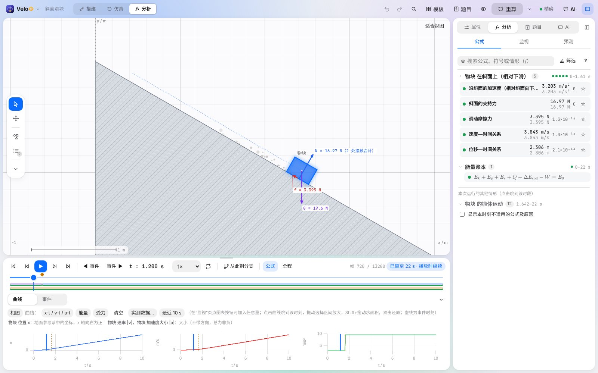
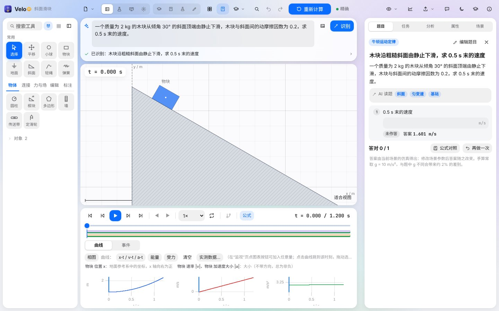
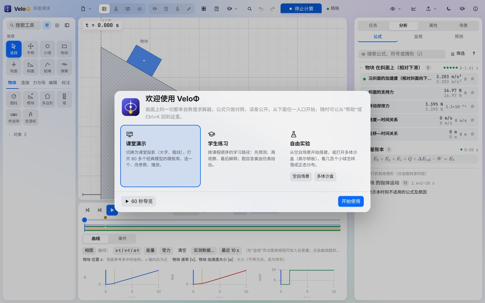
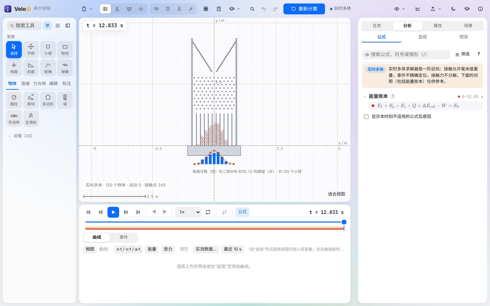
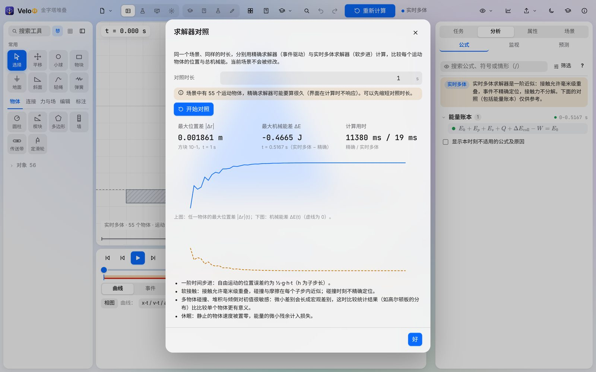
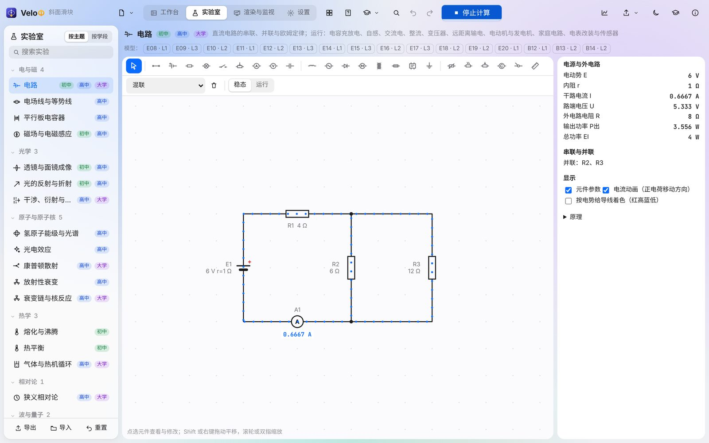

# VeloΦ (VeloPhi) 26.59

[English](README.md) · [简体中文](README.zh-CN.md) · **Deutsch**

VeloΦ ist eine 2D-Physiksimulation und Lernumgebung für Schülerinnen und Schüler, Studierende, Lehrkräfte und alle, die Physik verstehen wollen. Sie bauen eine Szene — Klötze, Kugeln, schiefe Ebenen, Seile, Federn, Ladungen, Schaltungen, Linsen —, starten sie und lesen jede Größe zu jedem Zeitpunkt ab. Erkannte Lehrbuchsituationen zeigen ihre Formeln mit Gültigkeitsbedingungen und eingesetzten Werten **neben** dem simulierten Ergebnis, die Abweichung offen sichtbar.

> Alles auf dem Bildschirm stammt aus dem numerischen Löser; Formeln werden nur verglichen, Fehler offen gezeigt. Das meinen wir mit *physikalisch nachprüfbar richtig*.



- **Repository:** <https://github.com/Stevenzhang543/VeloPhi>
- **Downloads:** <https://github.com/Stevenzhang543/VeloPhi/releases> (Windows portabel / Installer, Android-APK, Web-Version)
- **Sprachen:** 简体中文 · English · Deutsch (Einstellungen › Allgemein › Sprache; standardmäßig wie das System)

## Merkmale

- **Ein exakter Löser für den Unterricht.** Ereignisgesteuerte Integration (Dormand–Prince 5(4) mit Fehlerkontrolle oder symplektisches Gauß–Legendre); Kontakt-, Reibungs-, Stoß- und Seilzustände wechseln an Ereignissen, die auf etwa 10⁻¹² s bestimmt werden; Zwangskräfte werden exakt aus den Beschleunigungsgleichungen gelöst; die Energiebilanz schließt auf 10⁻⁸.
- **KI liest Aufgaben, Copilot hilft (neu in 26.59).** Eine Aufgabe einfügen oder ein Foto anhängen: Die KI liest sie, ordnet sie ein, wählt ein Modell und setzt die Parameter, und die Szene ist startbereit; Copilot beantwortet Fragen und kann die App für Sie bedienen. Die Arbeitsteilung ist strikt: Die KI *liest* und *handelt*, jede Zahlenantwort berechnet der Rechenkern.
- **Ein Mehrkörper-Löser.** Stapel, Schüttgut, Dominosteine und Galtonbretter mit Hunderten von Körpern, berechnet mit einem Soft-Step-Löser, der nach den zu Box2D v3 und Rapier veröffentlichten Verfahren neu implementiert wurde — und ein **Löservergleich**, der zeigt, wie weit er vom exakten Löser entfernt ist.
- **Formeln, die geprüft und nicht behauptet werden.** Rund 180 Modellfamilien mit Bedingungen in vier Zuständen, unabhängigen Referenzen und schrittweisen Herleitungen; Formeln sind nach Lehrplanstufe gestuft (chinesischer Lehrplan oder IB).
- **Labor.** Gleich- und Wechselstromkreise, elektrische und magnetische Felder, Linsen und Strahlenoptik, Wellenoptik, Wellen und Schall, 1D-Quantenmechanik, Gase und Wärmekraftmaschinen, radioaktiver Zerfall und Kernreaktionen, spezielle Relativitätstheorie.
- **Werkzeuge für den Unterricht.** Vorhersagen mit Sicherheitsangabe, Aufgaben aus eingefügtem Text, Lernpakete, Lernaktivitäten, Kräftepläne, Papierstreifen, Aufgabensammlungen, Versuchsberichte und Unterrichtsmaterial als Export.
- **Reproduzierbar.** Deterministische Mathematik: dieselbe Szene ergibt denselben SHA-256-Fingerabdruck in der Desktop-App, im Browser und in Node; ausgelagerte Bilder werden aus Prüfpunkten bitgenau neu berechnet.
- **Offen und offline.** Eine portable `.exe`, eine APK oder eine statische Web-Version; Simulation und Unterrichtswerkzeuge brauchen kein Konto, keinen Server und keine Plug-ins. Die KI-Funktionen arbeiten mit einem eigenen API-Schlüssel (OpenAI-kompatibel oder Anthropic) oder nach der Anmeldung mit einem whitelists.top-Konto mit der offiziellen KI.

## Neu in 26.59

| Bereich | Änderung |
| --- | --- |
| KI liest Aufgaben | **Aufgabe erkennen** in der Copilot-Leiste, der Reiter *Aufgabe* und die Aufgabensammlung lesen Aufgaben als Text, Bild oder beides. Die KI erkennt den Aufgabentyp und wählt einen von fünf Wegen — ein eingebautes Beispiel, eine Simulationsvorlage, einen der sechs Aufgabenbereiche, ein analytisches Modell oder, wenn keine Vorlage passt, eine **neu erzeugte Szene** — und übernimmt die Zahlen aus dem Text. Die App prüft jede Kennung, jeden Parameterbereich und jede Einheit (die KI darf ihre Antwort höchstens zweimal verbessern) und zeigt dann die Szene; jede Antwort wird aus der Simulation abgelesen. Bilder werden zuerst in Text übertragen, den Sie korrigieren und neu lesen lassen können. Eine Vorlage wird nur gewählt, wenn ihre Struktur alle Objekte der Aufgabe fasst; sonst baut die KI eine Szene (auch mit losen Rollen) oder ein **Gleichungsmodell**, das die App löst und auf Widersprüche prüft. Jede Erkennung liefert die von der App berechneten Antworten und einen kurzen **Lösungsweg**. |
| Copilot | Rechts im Fenster angedockt (Strg+I öffnet oder schließt). Beantwortet Fragen und bedient die App: öffnet Beispiele, lädt Vorlagen, ändert Parameter, zeigt Kraftpfeile und liest alle Kräfte auf einen Körper ab (Normalkraft, Reibung und Seilkraft berechnet die Engine), fügt Kräfte hinzu, baut Szenen, spielt ab, wechselt Seiten und Kurven, liest Ergebnisse ab oder **zeigt** mit einem Spotlight auf ein Bedienelement, damit Sie selbst klicken. Jede Änderung lässt sich im Chat rückgängig machen; „Erst fragen“ bestätigt jeden Schritt, und der **Lernmodus** gibt zuerst Hinweise und zeigt Antworten erst, nachdem die Lernenden geantwortet haben. Mit DeepSeek lässt sich neben dem Eingabefeld *Tiefdenken* einschalten. |
| Konto und offizielle KI | Optional: Mit einem whitelists.top-Konto anmelden (dieses Gerät im Browser bestätigen oder Benutzername und Passwort eingeben) und die offizielle KI mit Tageskontingent nutzen. Ohne Anmeldung einen eigenen Schlüssel eintragen — OpenAI-kompatibel (OpenAI, DeepSeek, Qwen, lokale Modelle …) oder Anthropic; Schlüssel bleiben auf Ihrem Rechner. |
| Aufgaben | Von 30 auf **82**, mit vier neuen Kapiteln: Elektrostatik, Magnetfelder und geladene Teilchen, elektromagnetische Induktion, Druck und Auftrieb. Filter nach Kapitel, Typ (28), Niveau und Schulstufe sowie Suche in Titeln, Texten und Schlagwörtern; von der KI gelesene Aufgaben lassen sich in *Meine Aufgaben* speichern. |
| Darstellung | Glas nur für obere Leiste, schwebende Ebenen und Copilot; Inhaltsbereiche sind deckend. Eine schlanke obere Leiste: Datei · Seiten · Vorlagen · Aufgaben · Unterricht · Ansicht · Rückgängig/Wiederholen · Suche · Neu berechnen mit Menü Berechnen · Hilfe · Copilot. Einheitliche Eckenradien und Bewegungen, *Transparenz reduzieren*, Trefferflächen von mindestens 24 px (44 px auf Touchscreens), eine Karte **Aufgabenparameter** oben in *Objekt*, die alles an einer Stelle ändert, und ein Telefon-Layout. |
| Android | Die erste **APK** (Android 8.0 oder neuer, arm64 und armv7). |



## Herunterladen und starten

| Datei | Inhalt |
| --- | --- |
| `VeloPhi-v26.59-windows-x64-portable.exe` | Portable Desktop-App: doppelklicken, es wird nichts installiert. |
| `VeloPhi-v26.59-windows-x64-setup.exe` | Installer derselben App (Startmenü, Deinstallation). |
| `VeloPhi-v26.59-android.apk` | Android-App (Android 8.0 oder neuer): auf dem Telefon öffnen und installieren (dem Browser oder Dateimanager das Installieren unbekannter Apps erlauben). |
| `VeloPhi-v26.59-web.zip` | Statische Web-Version: entpacken und den Ordner mit einem beliebigen statischen Webserver bereitstellen (sie braucht WebAssembly und läuft nicht über `file://`), z. B. `npx serve dist` oder `python -m http.server`. |
| `VeloPhi-v26.59-source.zip` | Quellcode dieser Version. |
| `VeloPhi-v26.59-release-evidence.zip` | Protokolle und Testberichte des Release-Builds. |

Voraussetzungen: Windows 10 oder 11 (x64) mit Microsoft Edge WebView2 (in aktuellen Windows-Versionen enthalten) Android 8.0 oder neuer mit System-WebView für die APK oder ein aktueller Desktop-Browser für die Web-Version. Downloads lassen sich mit `SHA256SUMS.txt` prüfen: `certutil -hashfile <Datei> SHA256`.

## Zehn-Minuten-Anleitung

1. **Erster Start.** Die Willkommensseite bietet vier Einstiege: *Im Unterricht zeigen* (Projektion und Vorlagen), *Üben* (Lernpfad), *Aufgabe einfügen* (KI liest die Aufgabe) und *Experimentieren* (leere Szene oder Mehrkörper-Sandkasten). Der *60-Sekunden-Rundgang* hebt die fünf Teile des Arbeitsbereichs nacheinander hervor. Später erreichen Sie die Seite über das Doktorhut-Symbol in der oberen Leiste oder Strg+K → „Willkommen und Rundgang“.

   

2. **Vorlage öffnen.** Auf **Vorlagen** klicken, ein klassisches Modell wählen (z. B. *Schiefe Ebene und Reibung › Schiefe Ebene: Haft- und Gleitreibung*), Parameter ändern und **Szene erstellen** wählen. Die Leertaste startet und pausiert, ← → gehen bildweise; Rauten auf der Zeitleiste sind Ereignisse (Stöße, Haften, Rutschbeginn) — ein Klick zeigt, was geschah und warum.
3. **Physik ablesen.** Rechts listet *Analyse › Formel* die Situationen des Laufs; jede Formel zeigt theoretischen Wert, simulierten Wert und Abweichung. Beim Überfahren einer Formel werden die gemeinten Körper, Kräfte und Winkel in der Zeichenfläche markiert. *Werte* liest alle Größen des gewählten Körpers in diesem Moment; *Details* öffnet Herleitungen und Lösungswege.
4. **Eigene Szene bauen.** Links ein Werkzeug wählen (Klotz, Kugel, schiefe Ebene, Seil, Feder, Gelenk, Motor …), in die Zeichenfläche klicken und durch Ziehen die Größe festlegen. Bearbeiten ist stufenlos und rastet nur in der Nähe anderer Körper ein (Alt halten schaltet das Einrasten ab). Jede Änderung rechnet automatisch neu.
5. **Zuerst vorhersagen.** Unter *Analyse › Prognose* schreiben Lernende vor dem Lauf einen Wert und ihre Sicherheit auf; danach wird jede Vorhersage mit Simulation und Formel verglichen. Eine sichere Vorhersage, die weit danebenliegt, wird als mögliche Fehlvorstellung markiert.
6. **Eine Aufgabe von der KI lesen lassen.** Unter *Einstellungen › Konto und KI* mit einem whitelists.top-Konto anmelden oder eigene Adresse, Modell und Schlüssel eintragen. Dann die Aufgabe in das Copilot-Feld rechts einfügen (oder mit der Bild-Schaltfläche ein Foto anhängen) und **Aufgabe erkennen** klicken (Strg+Eingabe): Szene, Parameter und Fragen werden eingerichtet, und der Aufgabenbereich zeigt die aus der Simulation abgelesenen Antworten. Die Ergebniszeile im Chat zeigt aufgeklappt, wie die KI die Aufgabe verstanden hat (Typ, Gegebenes, Annahmen), und Sie können weiter nachfragen. Ohne KI liest der regelbasierte Offline-Leser im Reiter *Aufgabe* weiterhin sechs Aufgabenbereiche.

   

7. **Copilot fragen.** Copilot sitzt rechts (Strg+I schließt oder öffnet ihn). Fragen Sie „Warum ist die Beschleunigung kleiner als ohne Reibung?“, sagen Sie „Stell den Winkel auf 40° und spiel ab“ oder „Zeig mir, wie ich das v‑t-Diagramm öffne“ (dann hebt er das Bedienelement hervor, und Sie klicken selbst). Jeder seiner Schritte steht in der Antwort und lässt sich rückgängig machen.
8. **Labor.** Die Seite *Labor* (Alt+2) enthält Schaltungen im Zeitbereich, Feldlinien, Linsen, Spektren, Zerfall, Quantentöpfe und mehr, jeweils mit Anzeigen und eingesetzten Formeln.
9. **Viele Körper.** *Viele Körper und Statistik › Galtonbrett* öffnen: 120 Kugeln fallen durch zehn Nagelreihen; unter dem Brett erscheinen die Anzahlen je Fach mit der binomialen Erwartung. Jede Szene kann unter *Szene › Rechnung* auf *Echtzeit-Mehrkörper* umgestellt werden (Teilschritte, Schrittrate, Schlafen). *Löservergleich…* rechnet exakten und Mehrkörper-Löser nebeneinander.

   

   

10. **Mit eigenen Messungen vergleichen.** Im Diagrammbereich liest *Messdaten…* eine CSV-Datei (`t (s), x (cm)` …), ordnet jeder Spalte eine Größe und Einheit zu und zeichnet die Punkte über die simulierte Kurve, mit mittlerer quadratischer Abweichung.
11. **Ergebnisse teilen.** *Ausgabe* exportiert CSV (mit Laufprotokoll), Video, einen Versuchsbericht (HTML/PDF) und Unterrichtsmaterial (Video, Bilder, Formelkarten, Herleitungen, optional PPTX).



**Tastenkürzel:** Leertaste Start/Pause · ←/→ Bild (Umschalt ×10) · Strg+Z / Strg+Y Rückgängig/Wiederholen · Strg+S Speichern · Strg+O Öffnen · Strg+Eingabe Neu berechnen · Alt+1/2/3/4 Arbeitsbereich / Labor / Monitor / Einstellungen · Strg+K alles durchsuchen · Strg+I Copilot. Die vollständige Liste steht unter *Einstellungen › Tastenkürzel*.

## Physik und Löser

| Löser | Einsatz | Genauigkeit |
| --- | --- | --- |
| Exakt (Dormand–Prince 5(4), Standard) | Unterrichtsszenen mit wenigen Körpern | Fehlerkontrolliert (relativ 10⁻¹⁰), Ereignisse auf ~10⁻¹² s, Energiebilanz ≤ 10⁻⁸ |
| Gauß–Legendre (symplektisch) | Lange konservative Läufe (Bahnen, Pendel) | Energie bleibt über lange Zeiten beschränkt |
| Moreau–Jean | Rückfall bei zu dichten Ereignissen | Reduziert: Ereignisse nicht bestimmt, in der Oberfläche gekennzeichnet |
| Echtzeit-Mehrkörper (Soft Step) | Stapel, Schüttgut, Dominosteine, Galtonbretter; Hunderte Körper | Erste Ordnung im Teilschritt, weiche Kontakte (Überlappung im Millimeterbereich), gekennzeichnet |

Alles wird in einem Rust-Kern berechnet: nativ in der Desktop-App und als WebAssembly im Browser — mit bitgleichen Ergebnissen. Der TypeScript-Kern von 26.52 bleibt als Testreferenz erhalten; wo er anwendbar ist, wird jede Rechnung bitgenau mit ihm verglichen.

## Aus dem Quellcode bauen

Voraussetzungen: Node.js 20+, Rust 1.90+ (mit dem Ziel `wasm32-unknown-unknown` für den Web-Kern) und für die Desktop-App die Tauri-Voraussetzungen unter Windows (WebView2, MSVC-Build-Tools). Die Android-Werkzeuge installiert `scripts/android/setup-android.ps1` nach `%LOCALAPPDATA%\VeloPhi-Android` (ohne Administratorrechte); Tauri braucht für Android-Builds unter Windows den *Entwicklermodus*. Der Signaturschlüssel entsteht in `%USERPROFILE%\.velophi-android` — bitte sichern: Spätere Versionen müssen mit demselben Schlüssel signiert sein, um sich über frühere installieren zu lassen.

```bash
npm ci
npm run dev                  # Entwicklungsserver unter http://localhost:5178
npx vitest run               # alle automatischen Tests
npm run typecheck            # vue-tsc
npm run build                # Typprüfung + Web-Version → dist/
scripts\build-engine.cmd     # Rust-Kern → src\engine\velophi_core.wasm (Windows)
node scripts/build-napi.mjs  # Rust-Kern als Node-API-Modul für die Tests (ohne wasm32-Ziel)
npx tauri build              # Windows-Desktop-App
scripts\android\build-apk.cmd # Android-APK: installiert beim ersten Mal JDK, Android SDK / NDK und die Rust-Ziele und erzeugt den Signaturschlüssel
scripts\release.cmd          # vollständiges Release unter Windows: Kerntests, WebAssembly, Tests, Tauri, Selbsttest, APK, Paketierung
```

Prüfungen des Kerns: `cargo test --release --workspace` in `engine/`, `node scripts/parity.mjs` (TypeScript-Referenz gegen nativen Rust-Kern, Bilder, Ereignisse und Prüfpunkte bitgenau), `node scripts/calc-parity.mjs` (alle Rechenoperationen), `node scripts/check-browser-hashes.cjs --worker` (Fingerabdrücke in Chromium).

## Projektstruktur

| Pfad | Inhalt |
| --- | --- |
| `engine/velophi-core` | Rust-Kern: Szenenmodell, exakter Löser, Mehrkörper-Löser (`src/world`), Ereignisse, Beobachtungsgrößen, Formeln, Labor, Sitzungen |
| `engine/velophi-wasm`, `velophi-native`, `velophi-cli`, `velophi-napi` | WebAssembly-Schnittstelle, nativer Desktop-Kern, Kommandozeilen-Läufer, Node-API-Testmodul |
| `src/app` | Vue-3-Oberfläche (Seiten, Bereiche, Dialoge, Editor) |
| `src/ai` | KI-Verbindungen (offiziell / OpenAI-kompatibel / Anthropic), Konto, Aufgaben-Lesepipeline (`import/`) und Copilot (`copilot/`) |
| `src/render` | Canvas-Darstellung (Körper, Kräfte, Felder, Histogramme, Effekte) |
| `src/templates`, `src/content`, `src/teaching`, `src/task` | Vorlagen, Modellregister und Lernpakete, Aktivitäten und Aufgaben, Aufgabenschicht |
| `src/i18n` | Oberflächentexte in drei Sprachen |
| `src-tauri` | Desktop- und Android-Hülle (Tauri 2); native Netzwerkanfragen (`src/net.rs`) |
| `tests`, `scripts` | Automatische Tests (mit der TypeScript-Referenz) und Build-/Prüfskripte (`scripts/android`: Android-Werkzeuge und APK) |

Entwicklungshandbücher, Berichte und Versionshinweise liegen außerhalb des Repositorys; jedes Release enthält seine Versionshinweise.

## Danksagung und Quellen

- Der Mehrkörper-Löser folgt den von Erin Catto für [Box2D v3](https://box2d.org/) ([Solver2D](https://box2d.org/posts/2024/02/solver2d/), MIT) und von Dimforge für [Rapier](https://rapier.rs/) (Apache-2.0) veröffentlichten Verfahren; der Code ist VeloΦs eigener.
- Gestaltungsideen für das Lernen mit Simulationen aus der Forschung zu [PhET Interactive Simulations](https://phet.colorado.edu/) (implizites Scaffolding).
- Paletten für Farbsehschwäche nach Okabe & Ito ([Color Universal Design](https://jfly.uni-koeln.de/color/)), [Paul Tol](https://personal.sron.nl/~pault/) und der farbenblindsicheren Palette der IBM Design Library; geprüft mit der Farbsehsimulation von Machado, Oliveira & Fernandes (2009).
- Gebaut mit [Rust](https://www.rust-lang.org/), [Vue](https://vuejs.org/), [Vite](https://vitejs.dev/), [Tauri](https://tauri.app/) und [uPlot](https://github.com/leeoniya/uPlot); Lizenzen von Drittkomponenten stehen in `THIRD_PARTY_NOTICES.md` jedes Releases.

## Lizenz

Die Lizenz dieses Repositorys legt der Maintainer fest; Komponenten Dritter behalten ihre eigenen Lizenzen (siehe `docs/THIRD_PARTY_NOTICES.md`).
