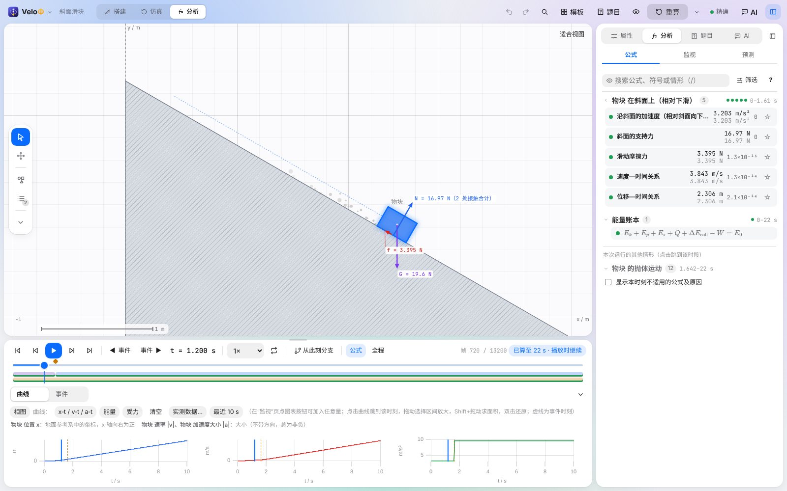
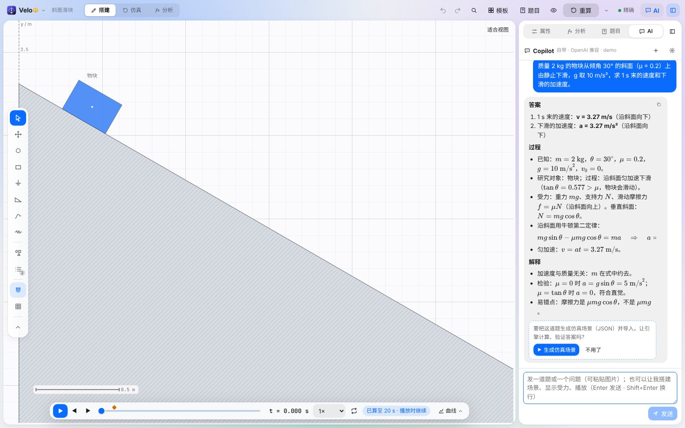
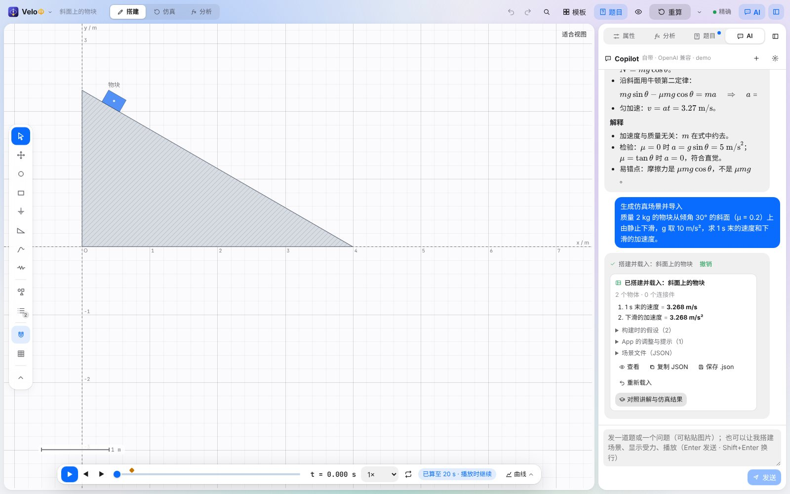
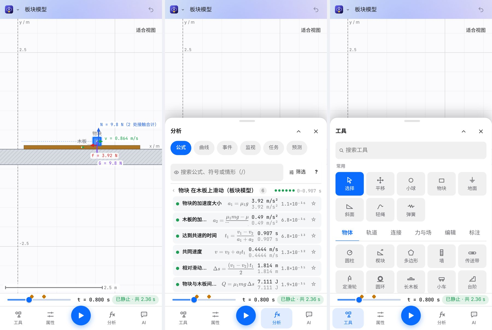
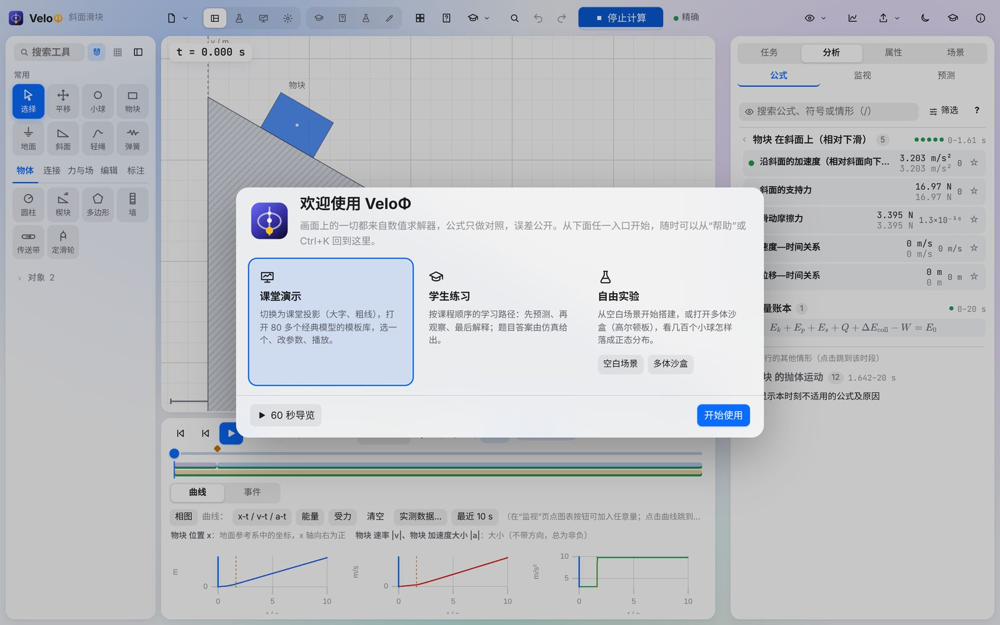
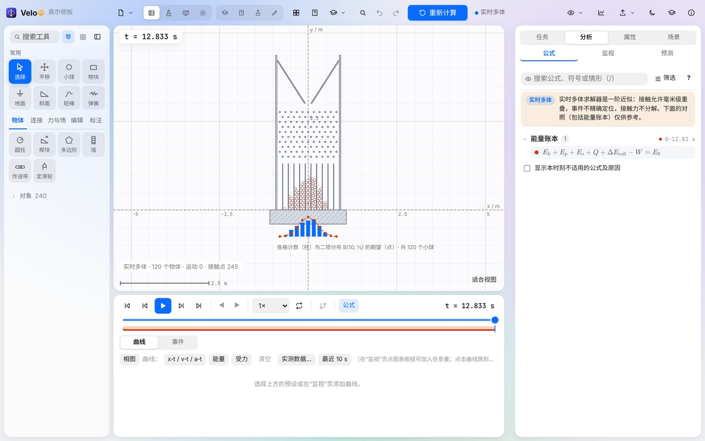
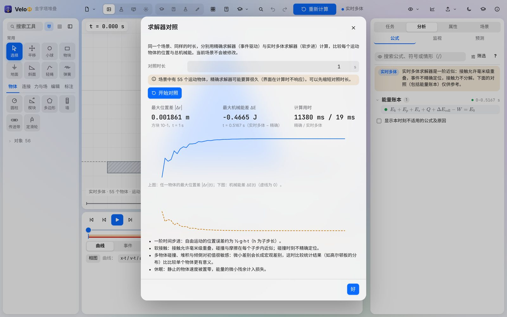
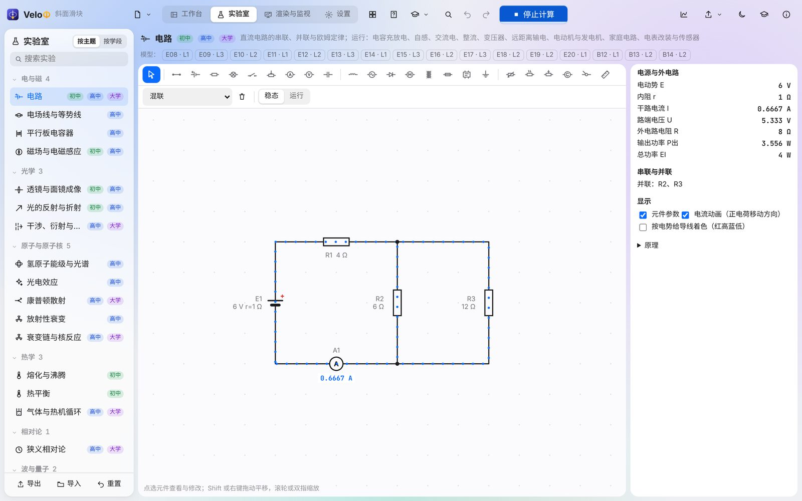

# VeloΦ (VeloPhi) 26.63

**English** · [简体中文](README.zh-CN.md) · [Deutsch](README.de.md)

VeloΦ is a 2D physics simulation and teaching engine for students, teachers and anyone curious about physics. You build a scene — blocks, balls, inclines, ropes, springs, charges, circuits, lenses — press play, and read every quantity at any moment. Recognised textbook situations show their formulas with conditions and substituted values **next to** the simulated result, with the error in plain view.

> Everything on the screen comes from the numerical solver; formulas are only compared, and errors are shown. That is what we mean by *physically verifiable*.



- **Repository:** <https://github.com/Stevenzhang543/VeloPhi>
- **Downloads:** <https://github.com/Stevenzhang543/VeloPhi/releases> (Windows portable / installer, Android APK, web build)
- **Languages:** 简体中文 · English · Deutsch (Settings › General › Language; follows the system by default)

## Highlights

- **An exact solver for teaching.** Event-driven integration (Dormand–Prince 5(4) with error control, or symplectic Gauss–Legendre); contact, friction, impacts and rope states change at events located to about 10⁻¹² s; constraint forces are solved exactly from the acceleration equations; an energy ledger closes to 10⁻⁸.
- **A canvas-first studio (new in 26.60).** One slim top bar with the modes *Build / Simulation / Analysis*, a floating tool strip, a floating timeline and one sidebar; on phones a bottom tab bar with bottom sheets.
- **Copilot and AI problem reading.** Send a problem as text or a photo: Copilot answers with the answer, the working and an explanation, and on request generates the simulation scene (a JSON scene file) so that the engine computes and checks the answers; it also answers questions and operates the app for you. The division of labour is strict: the AI *reads* and *acts*, the engine computes every numerical answer.
- **A many-body solver.** Stacks, piles, dominoes and Galton boards with hundreds of bodies, computed with a soft-step solver re-implemented after the algorithms published with Box2D v3 and Rapier — and a **solver comparison** that shows how far it is from the exact solver.
- **Formulas that are checked, not asserted.** 212 model families (180 of the capability blueprint and 32 for the curriculum) with conditions in four states, independent references and step-by-step derivations; formulas are graded by curriculum level (Chinese curriculum or IB).
- **Labs.** DC and AC circuits, electric and magnetic fields, lenses and ray optics, wave optics, waves and sound, 1D quantum mechanics, gases and heat engines, radioactive decay and nuclear reactions, special relativity.
- **Teaching tools.** Predictions with confidence, tasks from pasted problem text, teaching packages, learning activities, free-body diagrams, ticker tapes, problem sets, reports and courseware export.
- **Reproducible.** Deterministic maths: the same scene gives the same SHA-256 fingerprint in the desktop app, in the browser and in Node; checkpoints rebuild evicted frames bit for bit.
- **Open and offline.** One portable `.exe`, an APK or a static web build; simulation and teaching need no account, server or plug-in. The AI features work with your own API key (OpenAI-compatible or Anthropic format), or with the official AI after signing in with a whitelists.top account.

## What is new in 26.63

| Area | Change |
| --- | --- |
| A new shell | The pages are in a navigation rail at the left, in the order people use them: **Home**, **Workbench**, **Lab**, **Library**, **Classroom**, **Monitor**, then search, help and settings (a drawer on phones). Each page has its own context bar; the workbench and the monitor have a status bar (what the app is doing, the tool's hint, pointer position, snapping, zoom, frames and events). |
| Home, Library, Classroom | *Home*: one search, "continue", a box that takes a problem or a share link, and entries for learners, teachers and researchers. *Library*: templates, problems, the misconception index, the learning path, the model catalogue, the curriculum map and the handbook on one page. *Classroom*: predict-first cases, classroom experiments, activities and teacher tools. |
| Predict first — class tally | For a class with one projector and no student devices: ask a question with two to four options, count the hands, lock and run, reveal, then let the class discuss and vote once more — the card shows how the distribution moved (peer instruction). 16 ready-made cases, one per common misconception (heavier falls faster, the string breaks and the ball flies outward, static friction is always μN, …). |
| Feedback | Tooltips that appear next to the control, a shortcut sheet (press **?**), messages with an icon, a camera that glides when fitting or zooming, a ring where an impact happens, a play/pause flash; keys for the sidebar (Ctrl+\), its tabs (Ctrl+Alt+1…4), the curves drawer (Ctrl+J) and zoom (+, −, 0); on a phone held sideways the sheet stands beside the canvas. |
| Engine | **Ropes that break**: a rope with a tension limit breaks in an exact event when the tension reaches it and exerts no force afterwards. A geometry fix: two equal boxes side by side now pass a push on correctly. **Convergence study** for any scene: step halving against the exact solver, observed order, energy drift, a manifest and CSV. Projectile formulas no longer apply to a flight that was stopped on the way up. |
| Content | 7 new templates (the pendulum string breaks, off along the tangent, thrown and dropped, heavy and light, monkey and hunter, a growing pull, two blocks pushed), 8 new problems (98 in all), 16 misconception cases. |
| Share links | *File › Share link*: the scene travels inside the address (compressed); nothing is uploaded and no account is needed. Pasting a link into the home page opens it in the desktop app. |
| Copilot | One retry layer for busy services and dropped connections (honours `Retry-After`, otherwise backoff with jitter), request ids in the AI log and the repro package, a capability table per kind of service (strict schema, JSON mode, tools, a format together with an image), the "text and images are data" rule in every reading prompt, and a confirmation before a tool replaces a scene with unsaved changes. |

The research behind this release and the plan for the next ones are in `docs/ROADMAP_26_63.md` and `docs/research/2663/`. 26.62 brought the formula cards for circular tracks, the curriculum map and 32 model families — see its release notes.







## Download and run

| File | What it is |
| --- | --- |
| `VeloPhi-v26.63-windows-x64-portable.exe` | Portable desktop app: double-click, nothing is installed. |
| `VeloPhi-v26.63-windows-x64-setup.exe` | Installer for the same app (start menu entry, uninstaller). |
| `VeloPhi-v26.63-android.apk` | Android app (Android 8.0 or later): open it on the phone and install it (allow the browser or file manager to install unknown apps). |
| `VeloPhi-v26.63-web.zip` | Static web build: unzip and serve the folder with any static web server (it needs WebAssembly, so it does not run from `file://`), e.g. `npx serve dist` or `python -m http.server`. |
| `VeloPhi-v26.63-source.zip` | Source code of this release. |
| `VeloPhi-v26.63-release-evidence.zip` | Logs and test reports of the release build. |

Requirements: Windows 10 or 11 (x64) with Microsoft Edge WebView2 (already part of current Windows), Android 8.0 or later with the system WebView for the APK, or any current desktop browser for the web build. Check a download against `SHA256SUMS.txt`: `certutil -hashfile <file> SHA256`.

## Ten-minute tutorial

1. **First start.** The welcome page offers four ways in: *Teach a lesson* (projection mode and the template gallery), *Practise* (the learning path), *Paste a problem* (AI problem reading) and *Experiment* (an empty scene or the many-body sandbox). *60-second tour* lights up the five parts of the studio one by one (on a phone, the parts of the phone layout). You can come back later through *Help* in the menu or Ctrl+K → “Welcome and tour”.

   

2. **Open a template.** Click **Templates**, choose a classic model (e.g. *Inclines and friction › Incline: static and kinetic friction*), change its parameters and click **Create scene**. Space plays and pauses, ← → step frame by frame; diamonds on the timeline are events (impacts, sticking, start of sliding) — click one to see what happened and why. The run goes on while anything moves; the status next to the timeline tells how far it has computed.
3. **Read the physics.** Switch to the **Analysis** mode: the sidebar's *Analysis › Formula* lists the situations of the run; each formula shows the theoretical value, the simulated value and the error. Hover a formula to see the bodies, forces and angles it refers to on the canvas. *Monitor* reads every quantity of the selected body at this moment; *Details* opens derivations and worked solutions.
4. **Build your own scene.** In the **Build** mode, pick a tool on the strip at the left of the canvas (or *All tools*: block, ball, incline, arc track, rope, spring, hinge, motor …), click on the canvas to place it, drag to size it. Editing is continuous and snaps only near other bodies, into exact contact with edges lined up (hold Alt to switch snapping off); grid snapping is optional. Every change recomputes automatically.
5. **Predict first.** *Analysis › Predict* lets students write down a value and how sure they are before the run; after the run each prediction is compared with the simulation and the formula. A confident prediction that is far off is marked as a possible misconception.
6. **Solve a problem with Copilot.** In *Settings › Account and AI*, sign in with a whitelists.top account or enter your own endpoint, model and key. Open **AI** (top bar, sidebar tab or Ctrl+I; on a phone the AI tab at the bottom), paste a problem (or attach a photo) and press Enter: Copilot gives the answer, the working and an explanation. Choose **Generate simulation scene** under it to have the engine build the problem and compute the answers, then **Compare the explanation with the simulation**. Without AI, the offline rule-based reader in the *Task* tab still handles six problem domains.

   

7. **Ask Copilot.** Copilot is the AI tab of the sidebar (Ctrl+I opens or closes it). Ask “why is the acceleration smaller than without friction?”, say “set the angle to 40° and play”, or “show me how to open the v‑t graph” (it highlights the control so you can click it yourself). Every step it took is listed in its answer and can be undone.
8. **Labs.** The *Lab* page (navigation rail or Alt+3) has circuits that run in time, field lines, lenses, spectra, decay, quantum wells and more, each with readouts and substituted formulas.
9. **Many bodies.** Open *Many bodies and statistics › Galton board*: 120 balls fall through ten rows of pegs; under the board the counts per bin are drawn with the binomial expectation. Any scene can switch to *Real-time many-body* in *Scene › Calculation* (sub-steps, step rate, sleeping). *Solver comparison…* runs the exact and the many-body solver side by side.

   

   

10. **Compare with your own measurements.** In the chart panel, *Measured data…* reads a CSV file (`t (s), x (cm)` …), lets you map each column to a quantity and its unit, and draws the points over the simulated curve with the RMS deviation.
11. **Share results.** *Export* exports CSV (with a run manifest), video, a lab report (HTML/PDF) and courseware (video, screenshots, formula cards, derivations, optional PPTX).



**Shortcuts:** Space play/pause · ←/→ frame (Shift ×10) · Ctrl+Z / Ctrl+Y undo/redo · Ctrl+S save · Ctrl+O open · Ctrl+Enter recompute · Alt+1/2/3/4 studio / lab / monitor / settings · Ctrl+K search everything · Ctrl+I Copilot. The full list is under *Settings › Shortcuts*.

## Physics and solvers

| Solver | When to use | Accuracy |
| --- | --- | --- |
| Exact (Dormand–Prince 5(4), default) | Teaching scenes with a few bodies | Error-controlled (relative 10⁻¹⁰), events to ~10⁻¹² s, energy ledger ≤ 10⁻⁸ |
| Gauss–Legendre (symplectic) | Long conservative runs (orbits, pendulums) | Energy stays bounded over long times |
| Moreau–Jean | Fallback when events get too dense | Reduced: events not located, marked in the interface |
| Real-time many-body (Soft Step) | Stacks, piles, dominoes, Galton boards; hundreds of bodies | First order in the sub-step, soft contacts (millimetre overlaps), marked in the interface |

Everything is computed in a Rust core: natively in the desktop app and as WebAssembly in the browser — with bit-identical results. The 26.52 TypeScript engine is kept as a test reference, and every computation is compared with it bit for bit where it applies.

## Build from source

Requirements: Node.js 20+, Rust 1.90+ (with the `wasm32-unknown-unknown` target for the web core), and for the desktop app the Tauri prerequisites on Windows (WebView2, MSVC build tools). The Android toolchain is installed by `scripts/android/setup-android.ps1` into `%LOCALAPPDATA%\VeloPhi-Android` (no administrator rights); Tauri needs Windows *Developer Mode* to build for Android. The signing key is created in `%USERPROFILE%\.velophi-android` — back it up: later versions must be signed with the same key to install over earlier ones.

```bash
npm ci
npm run dev                  # development server at http://localhost:5178
npx vitest run               # all automated tests
npm run typecheck            # vue-tsc
npm run build                # type check + web build → dist/
scripts\build-engine.cmd     # Rust core → src\engine\velophi_core.wasm (Windows)
node scripts/build-napi.mjs  # Rust core as a Node-API module for the tests (no wasm32 target needed)
npx tauri build              # Windows desktop app
scripts\android\build-apk.cmd # Android APK: installs JDK, Android SDK / NDK and the Rust targets on first use and creates the signing key
scripts\release.cmd          # full release on Windows: engine tests, WebAssembly, tests, Tauri, self-check, APK, packaging
```

Engine checks: `cargo test --release --workspace` in `engine/`, `node scripts/parity.mjs` (TypeScript reference vs native Rust, frames, events and checkpoints bit for bit), `node scripts/calc-parity.mjs` (every calculation operation), `node scripts/check-browser-hashes.cjs --worker` (fingerprints in Chromium).

## Project structure

| Path | Content |
| --- | --- |
| `engine/velophi-core` | Rust core: scene model, exact solver, many-body solver (`src/world`), events, observations, formulas, labs, sessions |
| `engine/velophi-wasm`, `velophi-native`, `velophi-cli`, `velophi-napi` | WebAssembly interface, native desktop engine, command-line runner, Node-API test module |
| `src/app` | Vue 3 interface (pages, panels, dialogs, editor) |
| `src/ai` | AI connections (official / OpenAI-compatible / Anthropic), account, problem-reading pipeline (`import/`) and Copilot (`copilot/`) |
| `src/render` | Canvas rendering (bodies, forces, fields, histograms, effects) |
| `src/templates`, `src/content`, `src/teaching`, `src/task` | Templates, model registry and teaching packages, activities and problems, the task layer |
| `src/i18n` | Interface texts in three languages |
| `src-tauri` | Desktop and Android shell (Tauri 2); native network requests (`src/net.rs`) |
| `tests`, `scripts` | Automated tests (with the TypeScript reference engine) and build / check scripts (`scripts/android`: Android toolchain and APK) |

Development manuals, reports and release notes are kept outside the repository; each release contains its release notes.

## Acknowledgements and references

- The many-body solver follows the algorithms published by Erin Catto for [Box2D v3](https://box2d.org/) ([Solver2D](https://box2d.org/posts/2024/02/solver2d/), MIT) and by Dimforge for [Rapier](https://rapier.rs/) (Apache-2.0); the code is VeloΦ’s own.
- Design ideas for teaching with simulations from [PhET Interactive Simulations](https://phet.colorado.edu/) research (implicit scaffolding).
- Colour-vision palettes after Okabe & Ito ([Color Universal Design](https://jfly.uni-koeln.de/color/)), [Paul Tol](https://personal.sron.nl/~pault/) and the IBM Design Library colour-blind-safe palette; checked with the CVD simulation of Machado, Oliveira & Fernandes (2009).
- Built with [Rust](https://www.rust-lang.org/), [Vue](https://vuejs.org/), [Vite](https://vitejs.dev/), [Tauri](https://tauri.app/) and [uPlot](https://github.com/leeoniya/uPlot); third-party licences are listed in `THIRD_PARTY_NOTICES.md` of each release.

## Licence

The licence of this repository is chosen by the maintainer; third-party components keep their own licences (see `docs/THIRD_PARTY_NOTICES.md`).
