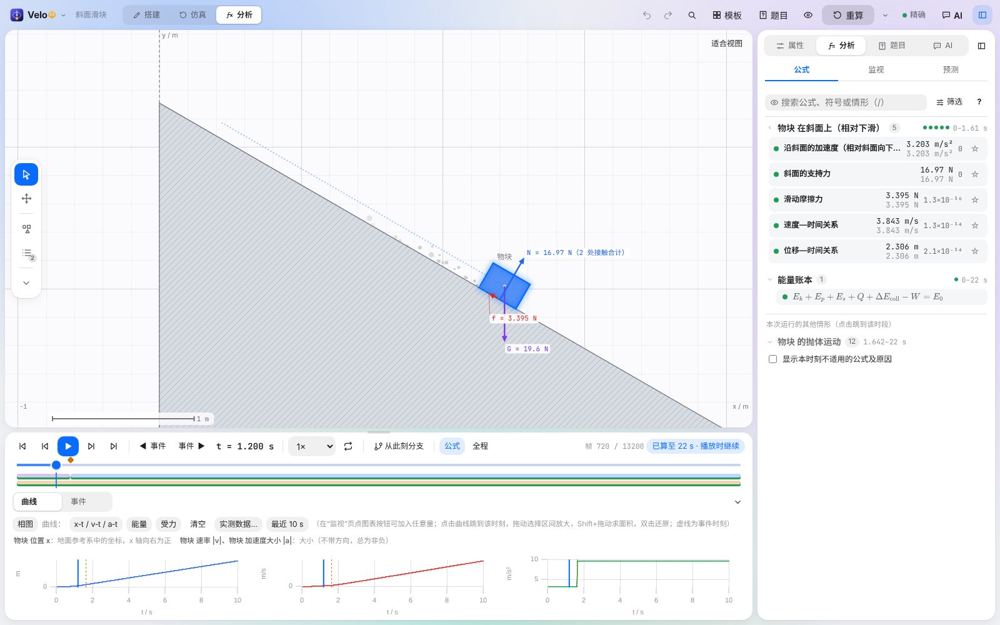
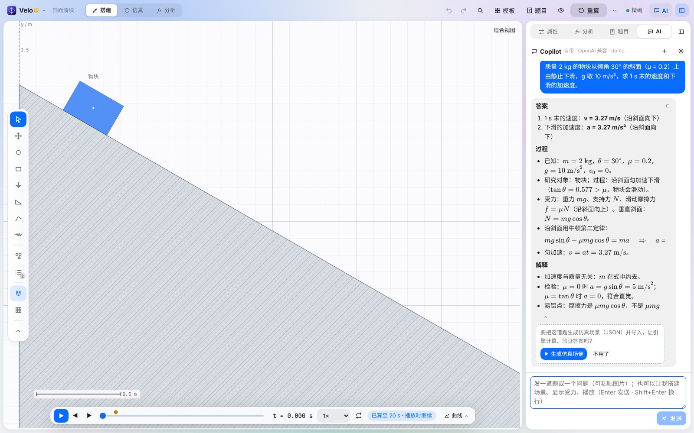
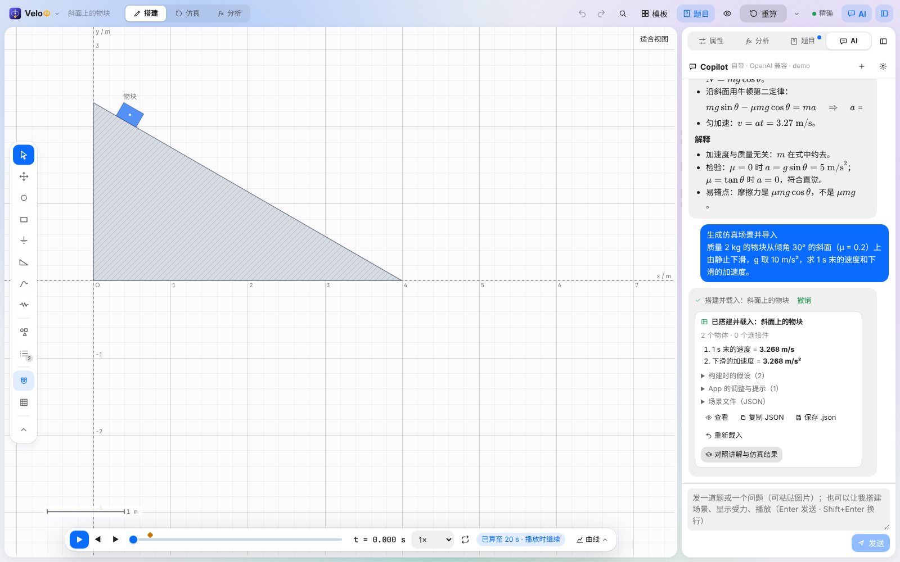
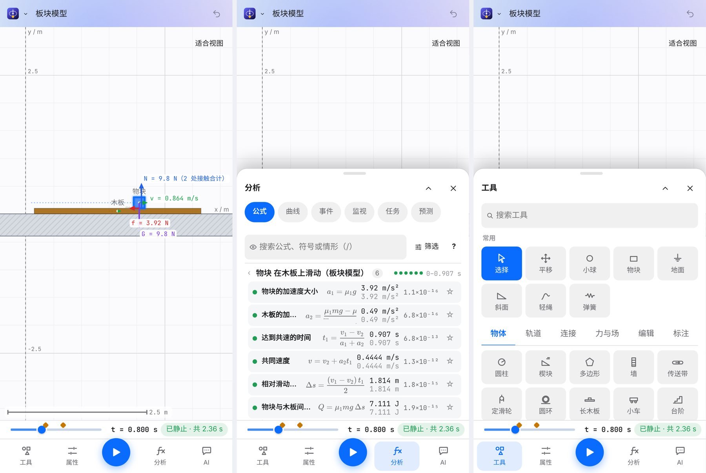
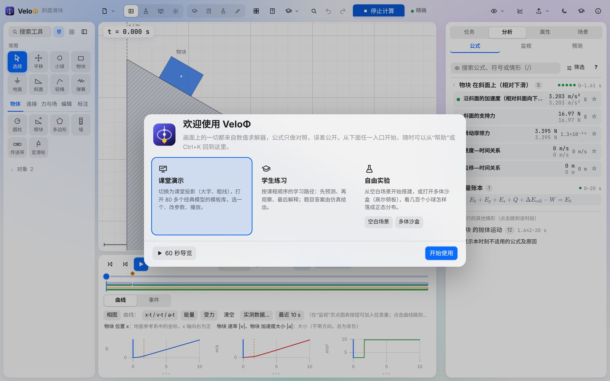
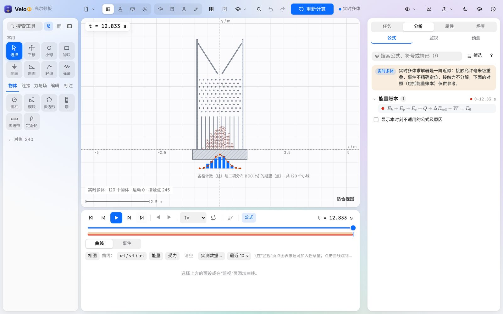
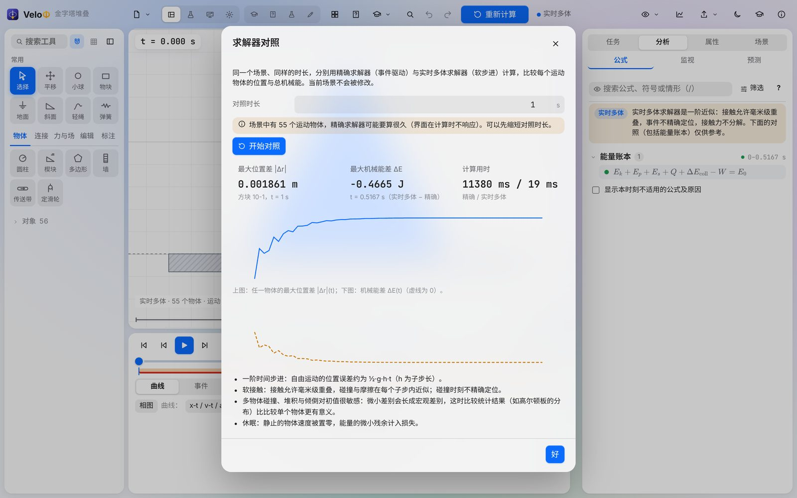
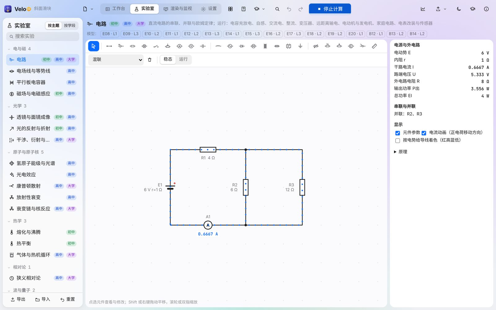

# VeloΦ (VeloPhi) 26.65

**English** · [简体中文](README.zh-CN.md) · [Deutsch](README.de.md)

VeloΦ is a physics and chemistry simulation and teaching engine for students, teachers and anyone curious about how things work. You build a scene — blocks, balls, inclines, ropes, springs, charges, circuits, lenses — press play, and read every quantity at any moment. Recognised textbook situations show their formulas with conditions and substituted values **next to** the simulated result, with the error in plain view.

> Everything on the screen comes from the numerical solver; formulas are only compared, and errors are shown. That is what we mean by *physically verifiable*.



- **Repository:** <https://github.com/Stevenzhang543/VeloPhi>
- **Downloads:** <https://github.com/Stevenzhang543/VeloPhi/releases> (Windows portable / installer, Linux deb / rpm / AppImage, Android APK, web build)
- **Languages:** 简体中文 · English · Deutsch (Settings › General › Language; follows the system by default)

## Highlights

- **A chemistry bench that computes (new in 26.64).** Reagents, glassware, heat, gases and electrodes on a bench whose every reading — pH, temperature, colour, mass of a precipitate, volume of a gas, cell voltage — comes from the chemistry core: equilibria on a network from the PHREEQC databases, declared reactions with rate laws, an energy balance. A periodic table and 553 substance pages with 3D structures; a nuclide chart and a reactor workshop.
- **An exact solver for teaching.** Event-driven integration (Dormand–Prince 5(4) with error control, or symplectic Gauss–Legendre); contact, friction, impacts and rope states change at events located to about 10⁻¹² s; constraint forces are solved exactly from the acceleration equations; an energy ledger closes to 10⁻⁸.
- **A canvas-first studio.** One bar above the canvas (file, undo, templates, run — and *Properties · Analysis · AI* at its end), a floating tool strip, a floating timeline and one inspector that follows the selection; on phones a bottom tab bar with bottom sheets.
- **Copilot and AI problem reading.** Send a problem as text or a photo: Copilot answers with the answer, the working and an explanation, and on request generates the simulation scene (a JSON scene file) so that the engine computes and checks the answers; it also answers questions and operates the app for you. The division of labour is strict: the AI *reads* and *acts*, the engine computes every numerical answer.
- **A many-body solver.** Stacks, piles, dominoes and Galton boards with hundreds of bodies, computed with a soft-step solver re-implemented after the algorithms published with Box2D v3 and Rapier — and a **solver comparison** that shows how far it is from the exact solver.
- **Formulas that are checked, not asserted.** 212 model families (180 of the capability blueprint and 32 for the curriculum) with conditions in four states, independent references and step-by-step derivations; formulas are graded by curriculum level (Chinese curriculum or IB).
- **Labs.** DC and AC circuits, electric and magnetic fields, lenses and ray optics, wave optics, waves and sound, 1D quantum mechanics, gases and heat engines, radioactive decay and nuclear reactions, special relativity.
- **Teaching tools.** Predictions with confidence, tasks from pasted problem text, teaching packages, learning activities, free-body diagrams, ticker tapes, problem sets, reports and courseware export.
- **Reproducible.** Deterministic maths: the same scene gives the same SHA-256 fingerprint in the desktop app, in the browser and in Node; checkpoints rebuild evicted frames bit for bit.
- **Open and offline.** One portable `.exe`, Linux packages, an APK or a static web build; simulation and teaching need no account, server or plug-in. The AI features work with your own API key (OpenAI-compatible or Anthropic format), or with the official AI after signing in with a whitelists.top account.

## What is new in 26.65

| Area | Change |
| --- | --- |
| One bar, one inspector | Every panel has one bar above its canvas. The physics lab goes from four stacked rows to one bar and one row of components; the motion studio drops the *Build / Simulation / Analysis* presets and picks the sidebar's view (*Properties · Analysis · Problems · AI*) at the end of its bar. The sidebar is one inspector: the selected object, or the whole scene when nothing is selected. Long explanations wait behind *Explanation*. |
| Start | Every start opens the home page (26.64's walkthrough could quietly change it). The opening screen follows the light or dark system theme. |
| Text and spacing | Real subscripts (v<sub>y</sub>, U<sub>AB</sub>) instead of underscores; full-width Chinese punctuation; the interface fonts on the canvas too; nothing below 12 px; leading per language; German decimal commas and hyphenation instead of ellipses; number fields show six significant digits at rest. |
| A calmer look | A flat logo and app icons, one treatment per surface (a hairline, or one shadow), five radii, no decorative ticks or key caps. |
| A hands-on chemistry bench | Drag a beaker or a reagent bottle over another vessel to pour, with the amount shown live; labelled bottles with stoppers; free placement with stands, clamps, rings, tripods and troughs that snap; burners, hot plates and baths as objects; droppers, spatulas and tweezers. Flames, smoke, sparks, a silver mirror, darting sodium and escaping coloured gases are drawn from the core's events, and mistakes have consequences the core computes (overflow, a stopper blown out, glass cracked by sudden cooling). Live curves of temperature, pH and gas volume. |
| Physics | Formula cards corrected (the board on a smooth floor, accelerations in many-body templates, rolling hoops, curved grooves, arc tracks, event instants, fast motion); 26 templates stop where the ground ends instead of letting bodies fall forever; labs refuse inputs that used to crash the core; canvas labels avoid each other and axes stay readable. |
| Linux (new) | A deb, an rpm and an AppImage for x86_64 (see below), with the same front end and core as on Windows, checked by the release self-check in containers of eight distributions. |

The roadmap and the decisions of this release are in `docs/ROADMAP_26_65.md`, the research behind them in `docs/research/2665/`.

## What came in 26.64

| Area | Change |
| --- | --- |
| Chemistry (new) | A **chemistry bench**: put glassware on the bench, add reagents (440 on the shelf), pour, heat, stopper, lead gases through tubes, wire electrodes — and the core computes what happens. Fast reactions (acid–base, complexes, precipitation, gas solubility) are an equilibrium solved for each vessel on a network built from the PHREEQC databases; slow ones (metals in acid, marble chips, peroxide, combustion — 211 declared reactions) run by rate laws; heat, boiling, gas pressure and electrochemistry (Nernst, Faraday, discharge order) follow. The colour of a solution is computed from the species in it (Beer–Lambert), so dilution pales it and ammonia turns copper sulfate deep blue. Three views of one vessel: what you see, the particles, and the species table with the balanced equation. |
| Guided experiments | 39 guided chemistry experiments (titration, gas preparation and collection, the properties of iron, copper and nitric acid, the zinc–copper cell, electrolysis of water and brine, electroplating, the NO2/N2O4 equilibrium, a fuel cell …). Every step is checked against the state of the core, never against a script; each experiment says what the model leaves out. |
| Elements and substances | A periodic table of 118 elements with property pages, electron configurations, orbitals and crystal structures in 3D, emission lines and flame colours; 553 substance pages with 3D structures (535 molecules and ions), properties, solubility curves and the reactions they take part in; "put on the bench" from any page. |
| Nuclides and a reactor workshop | A chart of 3558 nuclides (NUBASE2020 / AME2020) with nuclide pages and decay chains solved by the Bateman equations; a **reactor workshop** (two-group diffusion, point kinetics with thermal feedback, xenon and samarium, six guided tasks) as a teaching model, under Physics lab › Atoms and nuclei. |
| High-temperature gas equilibrium | Gibbs minimisation over 45 gas species with NASA polynomials: equilibrium compositions and adiabatic flame temperatures (agrees with Cantera to 10⁻⁶ K on 71 cases). |
| Five panels, less on the first level | The rail is now **Home · Motion · Physics lab · Chemistry · Library**; every page has the same skeleton (stage, one bar, one drawer) and at most seven controls on its first level — everything else is one level down or in the command palette, and a test proves that nothing of 26.63 was removed. A new design system (tokens, glass only where it helps, checked contrast). |
| Walkthrough | A first run is offered a walkthrough on the real interface: each step ends when you have done the thing (build, run, read; a circuit; a titration; the library), can be skipped, and resumes after a restart. Upgrading from 26.63 shows only what changed. |
| Copilot | Scenes are now built from a **sketch**: the model states the bodies, their relations and the given quantities; the program computes every coordinate and checks the result on a ladder of five levels before it is loaded. Twelve chemistry tools let Copilot work on the bench (add, pour, heat, read a vessel, balance an equation, look up a substance). |
| Updates | The desktop app and the Android app check for a new release at start (one HTTPS request to GitHub, can be switched off) and update with one click: the file is verified against the release's SHA-256 list before it is run. The web build never checks. |

The plan and the decisions of this release are in `docs/DEV_MANUAL_26_64.md`; data sources, licences and what was checked against which reference are in `docs/chem/DATA_SOURCES.md` and `docs/chem/VALIDATION.md`. 26.63 brought the navigation rail, the class tally and ropes that break — see its release notes.







## Download and run

| File | What it is |
| --- | --- |
| `VeloPhi-v26.65-windows-x64-portable.exe` | Portable desktop app: double-click, nothing is installed. |
| `VeloPhi-v26.65-windows-x64-setup.exe` | Installer for the same app (start menu entry, uninstaller). |
| `VeloPhi-v26.65-linux-amd64.deb` | Ubuntu 22.04 / 24.04, Debian 12 / 13, Linux Mint 21 / 22 and their derivatives: `sudo apt install ./VeloPhi-v26.65-linux-amd64.deb`; remove with `sudo apt remove velo-phi`. |
| `VeloPhi-v26.65-linux-x86_64.rpm` | Fedora 42 or later, openSUSE Leap 16 / Tumbleweed: `sudo dnf install ./VeloPhi-v26.65-linux-x86_64.rpm` (openSUSE: `sudo zypper install ./…rpm`); remove with `sudo dnf remove velo-phi`. |
| `VeloPhi-v26.65-linux-x86_64.AppImage` | Arch, Manjaro and other distributions, or without installing: `chmod +x` the file and run it (without FUSE: `--appimage-extract-and-run`). It carries WebKitGTK and GTK from Ubuntu 22.04, which do not receive the distribution's updates — prefer the deb or rpm where they fit. |
| `VeloPhi-v26.65-android.apk` | Android app (Android 8.0 or later): open it on the phone and install it (allow the browser or file manager to install unknown apps). |
| `VeloPhi-v26.65-web.zip` | Static web build: unzip and serve the folder with any static web server (it needs WebAssembly, so it does not run from `file://`), e.g. `npx serve dist` or `python -m http.server`. |
| `VeloPhi-v26.65-source.zip` | Source code of this release. |
| `VeloPhi-v26.65-release-evidence.zip` | Logs and test reports of the release build. |

Requirements: Windows 10 or 11 (x64) with Microsoft Edge WebView2 (already part of current Windows); Linux x86_64 with glibc 2.34 or later and WebKitGTK 4.1 (the deb and rpm install it; not supported: UOS 20, Kylin V10, Alpine; for a blank or flickering window start with `VELOPHI_SAFE_GRAPHICS=1 velophi`); Android 8.0 or later with the system WebView for the APK, or any current desktop browser for the web build. Check a download against `SHA256SUMS.txt`: `certutil -hashfile <file> SHA256` on Windows, `sha256sum -c --ignore-missing SHA256SUMS.txt` on Linux.

## Ten-minute tutorial

1. **First start.** The welcome page offers four ways in: *Teach a lesson* (projection mode and the template gallery), *Practise* (the learning path), *Paste a problem* (AI problem reading) and *Experiment* (an empty scene or the many-body sandbox). *60-second tour* lights up the five parts of the studio one by one (on a phone, the parts of the phone layout). You can come back later through *Help* in the menu or Ctrl+K → “Welcome and tour”.

   

2. **Open a template.** Click **Templates**, choose a classic model (e.g. *Inclines and friction › Incline: static and kinetic friction*), change its parameters and click **Create scene**. Space plays and pauses, ← → step frame by frame; diamonds on the timeline are events (impacts, sticking, start of sliding) — click one to see what happened and why. The run goes on while anything moves; the status next to the timeline tells how far it has computed.
3. **Read the physics.** Click **Analysis** at the end of the top bar: *Formula* lists the situations of the run; each formula shows the theoretical value, the simulated value and the error. Hover a formula to see the bodies, forces and angles it refers to on the canvas. *Monitor* reads every quantity of the selected body at this moment; *Details* opens derivations and worked solutions.
4. **Build your own scene.** Pick a tool on the strip at the left of the canvas (or *All tools*: block, ball, incline, arc track, rope, spring, hinge, motor …), click on the canvas to place it, drag to size it. Editing is continuous and snaps only near other bodies, into exact contact with edges lined up (hold Alt to switch snapping off); grid snapping is optional. Every change recomputes automatically.
5. **Predict first.** *Analysis › Predict* lets students write down a value and how sure they are before the run; after the run each prediction is compared with the simulation and the formula. A confident prediction that is far off is marked as a possible misconception.
6. **Solve a problem with Copilot.** In *Settings › Account and AI*, sign in with a whitelists.top account or enter your own endpoint, model and key. Open **AI** (at the end of the top bar or Ctrl+I; on a phone the AI tab at the bottom), paste a problem (or attach a photo) and press Enter: Copilot gives the answer, the working and an explanation. Choose **Generate simulation scene** under it to have the engine build the problem and compute the answers, then **Compare the explanation with the simulation**. Without AI, the offline rule-based reader in the *Task* tab still handles six problem domains.

   

7. **Ask Copilot.** Copilot is the *AI* view of the sidebar (the AI switch at the end of the top bar; Ctrl+I opens or closes it). Ask “why is the acceleration smaller than without friction?”, say “set the angle to 40° and play”, or “show me how to open the v‑t graph” (it highlights the control so you can click it yourself). Every step it took is listed in its answer and can be undone.
8. **Labs.** The *Physics lab* panel (navigation rail or Alt+2) has circuits that run in time, field lines, lenses, spectra, decay, quantum wells and more, each with readouts and substituted formulas.
9. **Many bodies.** Open *Many bodies and statistics › Galton board*: 120 balls fall through ten rows of pegs; under the board the counts per bin are drawn with the binomial expectation. Any scene can switch to *Real-time many-body* in *Scene › Calculation* (sub-steps, step rate, sleeping). *Solver comparison…* runs the exact and the many-body solver side by side.

   

   

10. **Compare with your own measurements.** In the chart panel, *Measured data…* reads a CSV file (`t (s), x (cm)` …), lets you map each column to a quantity and its unit, and draws the points over the simulated curve with the RMS deviation.
11. **Share results.** *Export* exports CSV (with a run manifest), video, a lab report (HTML/PDF) and courseware (video, screenshots, formula cards, derivations, optional PPTX).



**Shortcuts:** Space play/pause · ←/→ frame (Shift ×10) · Ctrl+Z / Ctrl+Y undo/redo · Ctrl+S save · Ctrl+O open · Ctrl+Enter recompute · Alt+1…5 Motion / Physics lab / Chemistry / Library / Monitor · Alt+0 home · Ctrl+K search everything · Ctrl+I Copilot. The full list is under *Settings › Shortcuts*.

## Physics and solvers

| Solver | When to use | Accuracy |
| --- | --- | --- |
| Exact (Dormand–Prince 5(4), default) | Teaching scenes with a few bodies | Error-controlled (relative 10⁻¹⁰), events to ~10⁻¹² s, energy ledger ≤ 10⁻⁸ |
| Gauss–Legendre (symplectic) | Long conservative runs (orbits, pendulums) | Energy stays bounded over long times |
| Moreau–Jean | Fallback when events get too dense | Reduced: events not located, marked in the interface |
| Real-time many-body (Soft Step) | Stacks, piles, dominoes, Galton boards; hundreds of bodies | First order in the sub-step, soft contacts (millimetre overlaps), marked in the interface |

Everything is computed in a Rust core: natively in the desktop app and as WebAssembly in the browser — with bit-identical results. The 26.52 TypeScript engine is kept as a test reference, and every computation is compared with it bit for bit where it applies.

## Build from source

Requirements: Node.js 20+, Rust 1.90+ (with the `wasm32-unknown-unknown` target for the web core), and for the desktop app the Tauri prerequisites on Windows (WebView2, MSVC build tools). The Android toolchain is installed by `scripts/android/setup-android.ps1` into `%LOCALAPPDATA%\VeloPhi-Android` (no administrator rights); Tauri needs Windows *Developer Mode* to build for Android. The signing key is created in `%USERPROFILE%\.velophi-android` — back it up: later versions must be signed with the same key to install over earlier ones.

```bash
npm ci
npm run dev                  # development server at http://localhost:5178
npx vitest run               # all automated tests
npm run typecheck            # vue-tsc
npm run build                # type check + web build → dist/
scripts\build-engine.cmd     # Rust core → src\engine\velophi_core.wasm (Windows)
node scripts/build-napi.mjs  # Rust core as a Node-API module for the tests (no wasm32 target needed)
npx tauri build              # Windows desktop app
scripts\android\build-apk.cmd # Android APK: installs JDK, Android SDK / NDK and the Rust targets on first use and creates the signing key
scripts\release.cmd          # full release on Windows: engine tests, WebAssembly, tests, Tauri, Linux packages, self-check, APK, packaging
```

The Linux packages are built in WSL on Ubuntu 22.04 from the `dist/` of the Windows build: `scripts/linux/setup-build-env.sh` creates the build distribution once, `wsl -d VeloPhi-Build-2204 -- bash scripts/linux/build-linux.sh 26.65` builds the deb, rpm and AppImage, and `scripts/linux/test-packages.sh` installs them in containers of several distributions and runs the self-check.

Engine checks: `cargo test --release --workspace` in `engine/`, `node scripts/parity.mjs` (TypeScript reference vs native Rust, frames, events and checkpoints bit for bit), `node scripts/calc-parity.mjs` (every calculation operation), `node scripts/check-browser-hashes.cjs --worker` (fingerprints in Chromium).

## Project structure

| Path | Content |
| --- | --- |
| `engine/velophi-core` | Rust core: scene model, exact solver, many-body solver (`src/world`), events, observations, formulas, labs, sessions |
| `engine/velophi-wasm`, `velophi-native`, `velophi-cli`, `velophi-napi` | WebAssembly interface, native desktop engine, command-line runner, Node-API test module |
| `src/app` | Vue 3 interface (pages, panels, dialogs, editor) |
| `src/ai` | AI connections (official / OpenAI-compatible / Anthropic), account, problem-reading pipeline (`import/`) and Copilot (`copilot/`) |
| `src/render` | Canvas rendering (bodies, forces, fields, histograms, effects) |
| `src/templates`, `src/content`, `src/teaching`, `src/task` | Templates, model registry and teaching packages, activities and problems, the task layer |
| `src/i18n` | Interface texts in three languages |
| `src-tauri` | Desktop and Android shell (Tauri 2); native network requests (`src/net.rs`) |
| `tests`, `scripts` | Automated tests (with the TypeScript reference engine) and build / check scripts (`scripts/android`: Android toolchain and APK; `scripts/linux`: Linux packages) |

Development manuals, reports and release notes are kept outside the repository; each release contains its release notes.

## Acknowledgements and references

- The many-body solver follows the algorithms published by Erin Catto for [Box2D v3](https://box2d.org/) ([Solver2D](https://box2d.org/posts/2024/02/solver2d/), MIT) and by Dimforge for [Rapier](https://rapier.rs/) (Apache-2.0); the code is VeloΦ’s own.
- Design ideas for teaching with simulations from [PhET Interactive Simulations](https://phet.colorado.edu/) research (implicit scaffolding).
- Colour-vision palettes after Okabe & Ito ([Color Universal Design](https://jfly.uni-koeln.de/color/)), [Paul Tol](https://personal.sron.nl/~pault/) and the IBM Design Library colour-blind-safe palette; checked with the CVD simulation of Machado, Oliveira & Fernandes (2009).
- Built with [Rust](https://www.rust-lang.org/), [Vue](https://vuejs.org/), [Vite](https://vitejs.dev/), [Tauri](https://tauri.app/) and [uPlot](https://github.com/leeoniya/uPlot); third-party licences are listed in `THIRD_PARTY_NOTICES.md` of each release.

## Licence

The licence of this repository is chosen by the maintainer; third-party components keep their own licences (see `docs/THIRD_PARTY_NOTICES.md`).
