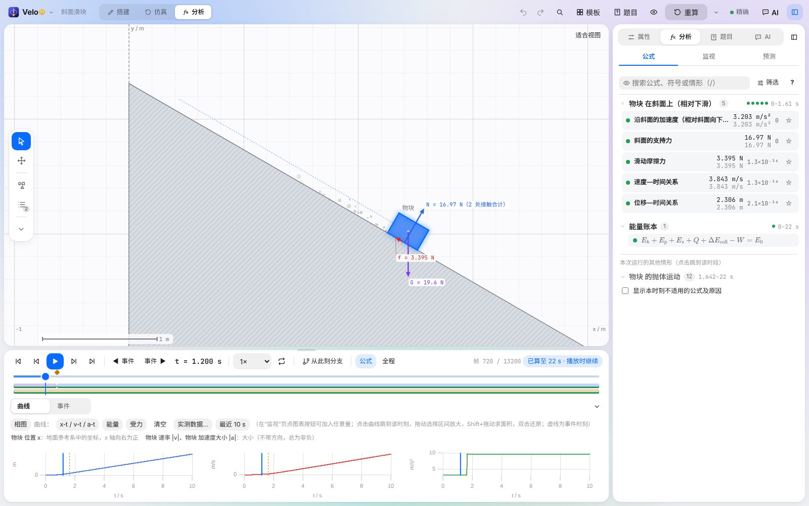
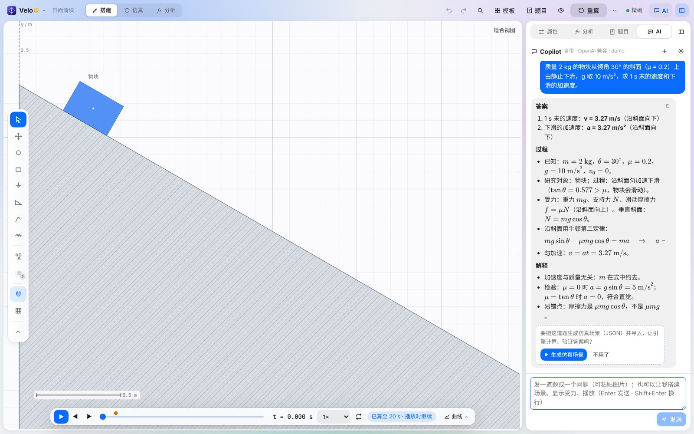
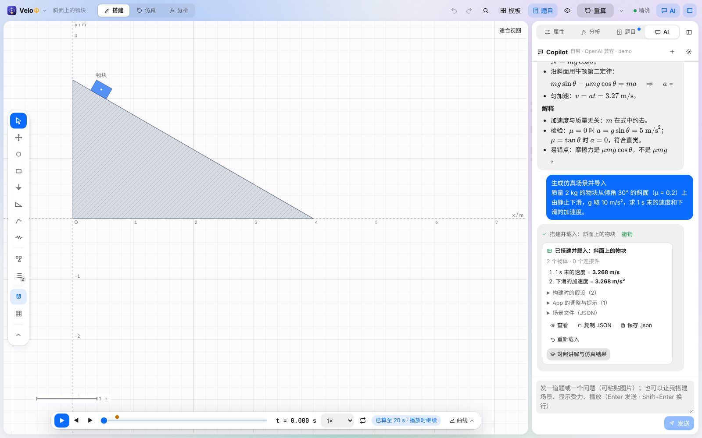
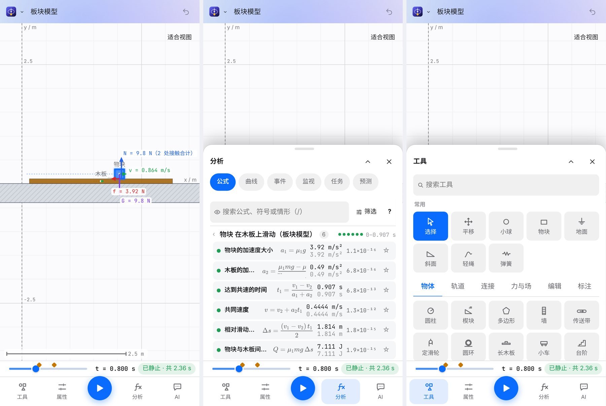
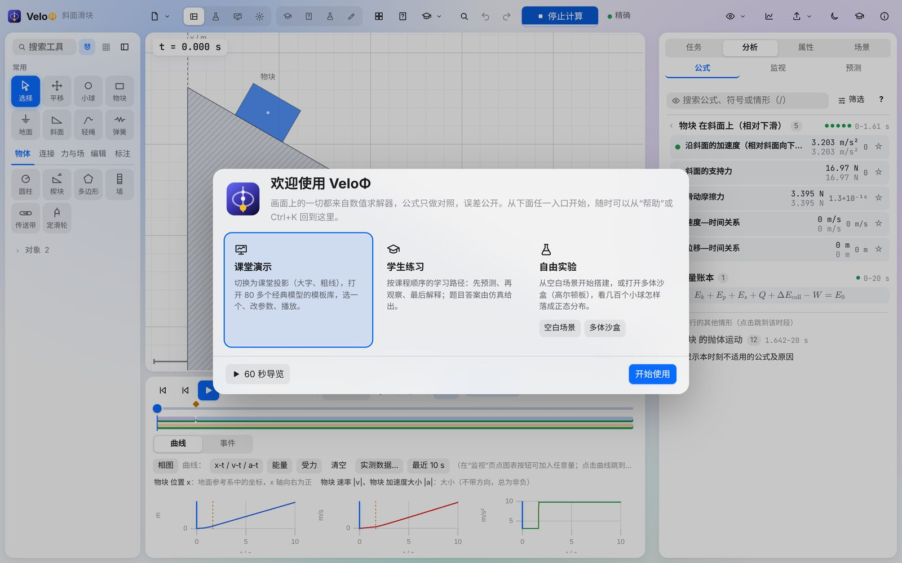
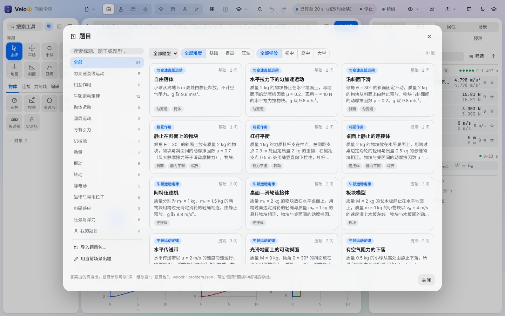
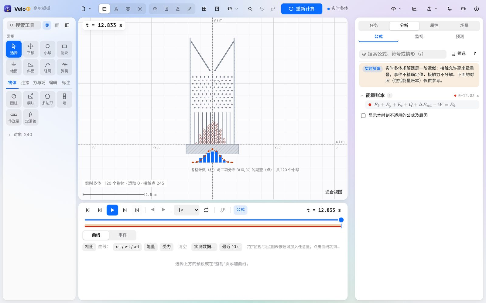
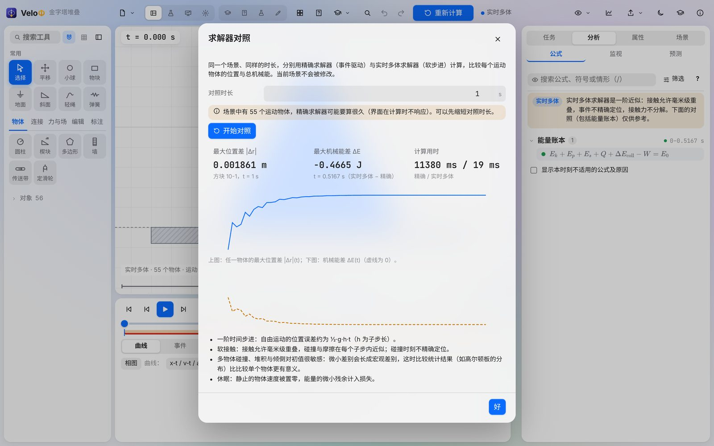
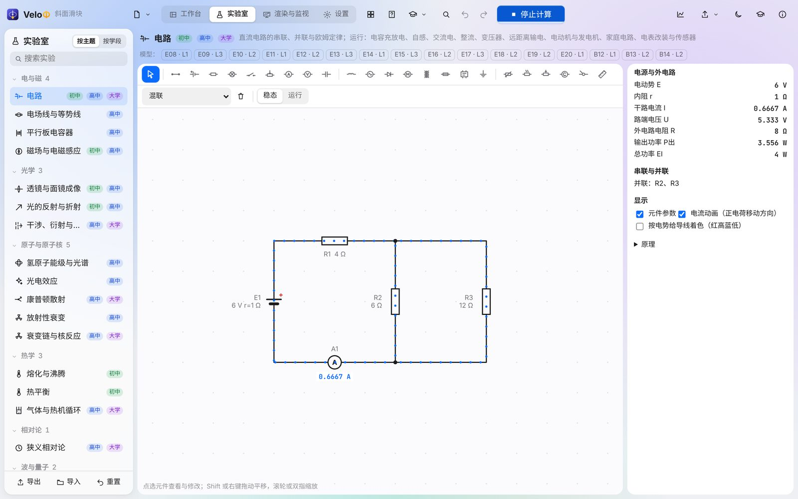

# VeloΦ（VeloPhi）26.65

[English](README.md) · **简体中文** · [Deutsch](README.de.md)

VeloΦ 是面向学生、教师和爱好者的物理与化学仿真教学引擎。搭一个场景——物块、小球、斜面、绳、弹簧、电荷、电路、透镜——按下播放，随时读出任意物体在任意时刻的物理量。系统识别典型情形，给出带适用条件的公式，代入数值后与仿真结果**并排**显示，误差公开。

> 画面上的一切都来自数值求解器，公式只做对照，误差公开——这就是“物理上可验证的正确”。



- **仓库：** <https://github.com/Stevenzhang543/VeloPhi>
- **下载：** <https://github.com/Stevenzhang543/VeloPhi/releases>（Windows 便携版 / 安装版、Linux deb / rpm / AppImage、安卓 APK、网页版）
- **界面语言：** 简体中文 · English · Deutsch（设置 › 通用 › 语言，默认跟随系统）

## 特色

- **会算的化学实验台（26.64 新增）。** 试剂、器材、加热、气体与电极；台面上的每个读数——pH、温度、颜色、沉淀的质量、气体的体积、电池的电压——都来自化学内核：基于 PHREEQC 数据库的平衡网络、带速率定律的声明反应、热量衡算。还有周期表与 553 个带三维结构的物质页、核素图与反应堆工坊。
- **为教学而做的精确求解器。** 事件驱动积分（带误差控制的 Dormand–Prince 5(4)，或辛 Gauss–Legendre）；接触、摩擦、碰撞与绳的状态在事件处切换，事件定位到约 10⁻¹² s；约束力由加速度方程精确解出；能量账本闭合到 10⁻⁸。
- **画布优先的工作台。** 画布上方一条栏（文件、撤销、模板、运行，末端是“属性 · 分析 · AI”）、浮动工具条、浮动时间轴和一个跟随选择的检查器；手机上是底部标签栏与底部抽屉。
- **Copilot 与 AI 读题。** 发一道题（文字或照片）：Copilot 给出答案、过程与解释，你可以再让它生成仿真场景（JSON 场景文件），由引擎计算并核对答案；它也回答问题、替你操作软件。分工明确：AI 负责“读”和“做”，每个数值答案都由引擎计算。
- **多体求解器。** 几百个物体的堆叠、颗粒、多米诺与高尔顿板，用按 Box2D v3 与 Rapier 公开算法重新实现的软步进求解器计算；**求解器对照**给出它与精确求解器差多少。
- **公式是核对出来的，不是宣称的。** 212 个模型族（能力蓝图 180 个、课程补充 32 个），条件四态、独立参照、逐步推导；公式按知识难度分级（中国课标或 IB）。
- **实验室。** 直流与交流电路、电场与磁场、透镜与光线、波动光学、机械波与声、一维量子力学、气体与热机、放射性衰变与核反应、狭义相对论。
- **教学工具。** 带把握程度的预测、粘贴题目文字的任务、教学包、学习活动、受力分析图、纸带、题库、实验报告与课件导出。
- **可复现。** 确定性数学库：同一场景在桌面版、浏览器与 Node 中得到相同的 SHA-256 指纹；被释放的帧块从检查点逐位相同地重算。
- **开放、离线。** 一个便携 `.exe`、Linux 安装包、一个 APK 或一份静态网页；仿真与教学功能不需要账户、服务器或插件。AI 功能可用自己的 API key（OpenAI 兼容或 Anthropic 格式），或登录 whitelists.top 账号后使用官方 AI。

## 26.65 的新内容

| 方面 | 变化 |
| --- | --- |
| 一条栏、一个检查器 | 每个面板的画布上方只有一条栏。物理实验从四层（页名、操作条、元件行、预设行）减到一条栏加一行元件；运动面板去掉了“搭建 / 仿真 / 分析”三个预设，侧栏看什么由栏末端的“属性 · 分析 · 题目 · AI”决定。侧栏只有一个检查器：选中物体时是物体，没有选中时是整个场景；长说明收进“解释”，点开才显示。 |
| 启动 | 每次启动都进首页（26.64 的新手引导可能悄悄改掉启动页）。开场画面跟随系统的浅色 / 深色。 |
| 文字与留白 | 真正的下标（v<sub>y</sub>、U<sub>AB</sub>）代替下划线；中文标点是全角；画布与界面用同一套字体；不小于 12 px；中文单独的行高；德文用小数逗号、自动断词代替省略号；数字框静止时显示六位有效数字。 |
| 更安静的外观 | 扁平的标志与应用图标；每个面只用一种处理（一圈细线或一层阴影）；五档圆角；去掉装饰性的刻度线与键帽。 |
| 能动手的化学实验台 | 把烧杯或试剂瓶拖到另一个容器口上就能倒，实时显示倒了多少；贴标签、带瓶塞的试剂瓶；器材自由摆放，铁架台、铁夹、铁圈、三脚架、水槽可吸附组装；酒精灯、电热板、水浴是独立物件；胶头滴管、药匙、镊子。火焰、烟、火花、银镜、钠在水面游动、有色气体逸出都按化学内核的事件画出；错误操作有内核算出的后果（溢出、冲开塞子、热玻璃遇冷破裂）。温度、pH、气体体积的实时曲线。 |
| 物理 | 公式卡修正（光滑地面上的板块、多体模板的加速度、滚动的圆环、曲面凹槽、圆弧滑道、事件时刻、快速运动）；26 个模板在地面尽头停止，不再一直往下掉；实验拒绝会让计算核心崩溃的输入；画布标签互相避让，坐标轴保持可读。 |
| Linux（新增） | x86_64 的 deb、rpm 与 AppImage（见下），界面与计算核心和 Windows 版是同一份字节，在八个发行版的容器里通过了发布自检。 |

本版的路线图与决策见 `docs/ROADMAP_26_65.md`，背后的调研见 `docs/research/2665/`。

## 26.64 带来的

| 方面 | 改动 |
| --- | --- |
| 化学（新） | **化学实验台**：把器材放上台面，加试剂（试剂架上 440 种）、倾倒、加热、塞塞子、用导管通气、接电极——发生什么由内核算出。快反应（酸碱、络合、沉淀、气体溶解）按每个容器的平衡求解，反应网络由 PHREEQC 数据库生成；慢反应（金属与酸、大理石与酸、过氧化氢分解、燃烧等 211 条）按速率定律推进；热量、沸腾、气体压强与电化学（能斯特方程、法拉第定律、放电顺序）随之而来。溶液的颜色由其中的物种按比尔定律算出，所以稀释会变浅，硫酸铜加氨水会变成深蓝。同一个容器有三种表征：宏观、微观粒子、物种表与配平的方程式。 |
| 引导实验 | 39 个化学引导实验（滴定、气体的制取与收集、铁的性质、铜与硝酸、锌铜原电池、电解水与食盐水、电镀、NO₂/N₂O₄ 平衡、燃料电池等）。每一步都对照内核的状态检查，不是照脚本播放；每个实验写明模型没有覆盖的部分。 |
| 元素与物质 | 118 个元素的周期表与元素页：性质、电子排布、轨道与晶体结构的三维图、发射谱线与焰色；553 个物质页：三维结构（535 个分子与离子）、性质、溶解度曲线、参与的反应；任何一页都可以“放到实验台”。 |
| 核素与反应堆工坊 | 3558 个核素的核素图（NUBASE2020 / AME2020）、核素页，以及用 Bateman 方程求解的衰变链；**反应堆工坊**（两群扩散、带热反馈的点堆动力学、氙与钐中毒、六个引导任务）作为教学模型，在“物理实验 › 原子与核”。 |
| 高温气相平衡 | 45 个气相物种、NASA 多项式的吉布斯自由能最小化：平衡组成与绝热火焰温度（71 个算例与 Cantera 相差不到 10⁻⁶ K）。 |
| 五个面板，第一层更少 | 导航栏现在是 **首页 · 运动 · 物理实验 · 化学 · 资源库**；每个页面同一副骨架（舞台、一条栏、一个抽屉），第一层最多七个控件——其余在下一层或命令面板里，并有测试证明 26.63 的功能一个不少。新的设计系统（设计令牌、只在有用的地方用玻璃、对比度经过检查）。 |
| 新手引导 | 第一次运行可以在真实界面上走一遍：每一步在你做完那件事时结束（搭建、运行、读数；一个电路；一次滴定；资源库），可以跳过，重启后接着走。从 26.63 升级只显示新变化。 |
| Copilot | 场景改由**草图**生成：模型只说有哪些物体、它们的关系和已知量；坐标全部由程序计算，并经过五级检查才载入。十二个化学工具让 Copilot 能在实验台上操作（加液、倾倒、加热、读容器、配平方程式、查物质）。 |
| 更新 | 桌面版与安卓版每次启动时检查新版本（向 GitHub 发一次 HTTPS 请求，可以关闭），一键更新：文件先对照发布页的 SHA-256 清单校验，通过后才运行。网页版不检查。 |

这一版的计划与决策见 `docs/DEV_MANUAL_26_64.md`；数据来源、许可，以及各部分对照了哪个参考，见 `docs/chem/DATA_SOURCES.md` 与 `docs/chem/VALIDATION.md`。26.63 带来了导航栏、班级预测统计和可断的绳，详见其发布说明。







## 下载与运行

| 文件 | 说明 |
| --- | --- |
| `VeloPhi-v26.65-windows-x64-portable.exe` | 便携桌面版：双击即用，不安装任何东西。 |
| `VeloPhi-v26.65-windows-x64-setup.exe` | 同一程序的安装版（开始菜单、卸载程序）。 |
| `VeloPhi-v26.65-linux-amd64.deb` | Ubuntu 22.04 / 24.04、Debian 12 / 13、Linux Mint 21 / 22 及其衍生版：`sudo apt install ./VeloPhi-v26.65-linux-amd64.deb`；卸载 `sudo apt remove velo-phi`。 |
| `VeloPhi-v26.65-linux-x86_64.rpm` | Fedora 42 及以后、openSUSE Leap 16 / Tumbleweed：`sudo dnf install ./VeloPhi-v26.65-linux-x86_64.rpm`（openSUSE：`sudo zypper install ./…rpm`）；卸载 `sudo dnf remove velo-phi`。 |
| `VeloPhi-v26.65-linux-x86_64.AppImage` | Arch、Manjaro 等其余发行版，或不想安装时：`chmod +x` 后直接运行（没有 FUSE 时加 `--appimage-extract-and-run`）。它自带 Ubuntu 22.04 的 WebKitGTK 与 GTK，不会随系统更新——能用 deb 或 rpm 时优先用它们。 |
| `VeloPhi-v26.65-android.apk` | 安卓版（Android 8.0 及以上）：在手机上打开并安装（需允许浏览器或文件管理器“安装未知应用”）。 |
| `VeloPhi-v26.65-web.zip` | 静态网页版：解压后用任意静态网页服务器提供该目录（需要 WebAssembly，不能直接用 `file://` 打开），如 `npx serve dist` 或 `python -m http.server`。 |
| `VeloPhi-v26.65-source.zip` | 本版源码。 |
| `VeloPhi-v26.65-release-evidence.zip` | 发布构建的日志与测试报告。 |

要求：Windows 10 或 11（x64），带 Microsoft Edge WebView2（新版 Windows 已自带）；Linux 需要 x86_64、glibc 2.34 及以上与 WebKitGTK 4.1（deb 与 rpm 会自动安装；不支持 UOS 20、银河麒麟 V10、Alpine；窗口空白或闪烁时用 `VELOPHI_SAFE_GRAPHICS=1 velophi` 启动）；安卓版需要 Android 8.0 及以上与系统 WebView；网页版用任意新版桌面浏览器。可用 `SHA256SUMS.txt` 核对下载：Windows 上 `certutil -hashfile <文件> SHA256`，Linux 上 `sha256sum -c --ignore-missing SHA256SUMS.txt`。

## 十分钟教程

1. **第一次启动。** 欢迎页给出四个入口：“课堂演示”（课堂投影与模板库）、“学生练习”（学习路径）、“粘贴一道题”（AI 读题）、“自由实验”（空白场景或多体沙盒）。“60 秒导览”依次点亮工作台的五个部分（手机上是手机布局的各部分）。之后可从菜单的“帮助”或 Ctrl+K →“欢迎与导览”回到这里。

   

2. **打开模板。** 点“模板”，选一个经典模型（如“斜面与摩擦 › 斜面：静摩擦与动摩擦”），改参数后点“创建场景”。空格播放 / 暂停，← → 逐帧；时间轴上的菱形是事件（碰撞、共速、开始滑动），点一下看发生了什么、为什么。只要还有物体在动就会一直算下去，时间轴旁的状态说明算到了哪里。
3. **读物理。** 点顶栏末端的“分析”：“公式”列出本次运行的情形；每条公式给出理论值、仿真值与误差。悬停公式时，画布上标出它所指的物体、力与角度。“监视”读出所选物体此刻的全部物理量；“详情”打开推导与逐步解题。
4. **自己搭场景。** 从画布左侧的工具条选工具（或打开“全部工具”：物块、小球、斜面、圆弧轨道、绳、弹簧、铰链、马达……），在画布上单击放置，拖拽设定大小。编辑是连续的，只在贴近其他物体时吸到刚好接触并齐边（按住 Alt 关闭吸附）；网格吸附可选。每次修改都会自动重新计算。
5. **先预测。** “分析 › 预测”让学生在运行前写下数值与把握程度；运行后每条预测都与仿真和公式对照。有把握却偏差较大的预测会被标为可能的误概念。
6. **用 Copilot 解题。** 先在“设置 › 账号与 AI”中登录 whitelists.top 账号，或填入自己的接口地址、模型与 key。打开 **AI**（顶栏末端或 Ctrl+I；手机上是底部的 AI），粘贴题目（或附上题目照片）按 Enter：Copilot 给出答案、过程与解释。点下方的“生成仿真场景”，由引擎把题目搭出来并算出答案，再点“对照讲解与仿真结果”。不用 AI 时，“任务”页的离线规则读题仍支持六类题型。

   

7. **问 Copilot。** Copilot 是侧栏的“AI”视图（顶栏末端的 AI 开关；Ctrl+I 打开或收起）：可以问“为什么加速度比无摩擦时小”，也可以说“帮我把倾角改成 40 度再播放”或“教我怎么看 v‑t 图”（它会圈出按钮让你自己点）。它做过的每一步都列在回答里，点“撤销”即可还原。
8. **实验室。** “物理实验”面板（导航栏或 Alt+2）有可时域运行的电路、电场线、透镜、光谱、衰变、量子势阱等，每个实验都有读数与代入数值的公式。
9. **多物体。** 打开“多体与统计 › 高尔顿板”：120 个小球穿过十行钉子，板下画出各格计数与二项分布的期望。任何场景都可在“场景 › 计算”中改用“实时多体”（子步数、步频、休眠）。“求解器对照…”把精确求解器与多体求解器并排比较。

   

   

10. **与自己的测量对照。** 曲线面板的“实测数据…”读入 CSV 文件（`t (s), x (cm)`……），为每一列选择对应的物理量与单位，把数据点画在仿真曲线上并给出均方根偏差。
11. **分享结果。** “输出”可导出 CSV（附运行清单）、视频、实验报告（HTML / PDF）与课件（视频、截图、公式卡、推导页，可选 PPTX）。



**快捷键：** 空格 播放 / 暂停 · ←/→ 逐帧（Shift ×10）· Ctrl+Z / Ctrl+Y 撤销 / 重做 · Ctrl+S 保存 · Ctrl+O 打开 · Ctrl+Enter 重新计算 · Alt+1…5 运动 / 物理实验 / 化学实验 / 资源库 / 监视 · Alt+0 首页 · Ctrl+K 全局搜索 · Ctrl+I Copilot。完整列表见“设置 › 快捷键”。

## 物理与求解器

| 求解器 | 适用 | 精度 |
| --- | --- | --- |
| 精确（Dormand–Prince 5(4)，默认） | 物体不多的教学场景 | 误差受控（相对 10⁻¹⁰），事件到约 10⁻¹² s，能量账本 ≤ 10⁻⁸ |
| Gauss–Legendre（辛方法） | 长时间的守恒系统（轨道、单摆） | 长时间能量有界 |
| Moreau–Jean | 事件过密时的回退 | 降阶：事件不精确定位，界面中标出 |
| 实时多体（Soft Step） | 堆叠、颗粒、多米诺、高尔顿板，几百个物体 | 随子步长一阶，软接触（毫米级重叠），界面中标出 |

全部计算都在 Rust 核心中：桌面版原生运行，浏览器中以 WebAssembly 运行，结果逐位相同。26.52 的 TypeScript 引擎保留为测试参照，适用的计算都与它逐位对照。

## 从源码构建

需要：Node.js 20+、Rust 1.90+（网页版核心需要 `wasm32-unknown-unknown` 目标）；桌面版需要 Windows 上的 Tauri 前置条件（WebView2、MSVC 构建工具）。安卓版的工具链由 `scripts/android/setup-android.ps1` 安装到 `%LOCALAPPDATA%\VeloPhi-Android`（不需要管理员权限）；Tauri 在 Windows 上构建安卓需要开启“开发者模式”。签名密钥生成在 `%USERPROFILE%\.velophi-android`，请备份：以后的版本必须用同一把密钥签名才能覆盖安装。

```bash
npm ci
npm run dev                  # 开发服务器 http://localhost:5178
npx vitest run               # 全部自动测试
npm run typecheck            # vue-tsc
npm run build                # 类型检查 + 网页版 → dist/
scripts\build-engine.cmd     # Rust 核心 → src\engine\velophi_core.wasm（Windows）
node scripts/build-napi.mjs  # 测试用的 Rust 核心 Node-API 模块（不需要 wasm32 目标）
npx tauri build              # Windows 桌面版
scripts\android\build-apk.cmd # 安卓 APK：第一次运行时自动安装 JDK、Android SDK / NDK 与 Rust 目标，并生成签名密钥
scripts\release.cmd          # Windows 上的完整发布：引擎测试、WebAssembly、测试、Tauri、Linux 安装包、自检、APK、打包
```

Linux 安装包在 WSL 的 Ubuntu 22.04 里由 Windows 构建的 `dist/` 打出：`scripts/linux/setup-build-env.sh` 一次性建好构建环境，`wsl -d VeloPhi-Build-2204 -- bash scripts/linux/build-linux.sh 26.65` 构建 deb、rpm 与 AppImage，`scripts/linux/test-packages.sh` 把它们装进几个发行版的容器并运行自检。

引擎检查：在 `engine/` 中 `cargo test --release --workspace`；`node scripts/parity.mjs`（TypeScript 参照与原生 Rust，帧、事件、检查点逐位对照）；`node scripts/calc-parity.mjs`（全部计算操作）；`node scripts/check-browser-hashes.cjs --worker`（Chromium 中的指纹）。

## 目录结构

| 路径 | 内容 |
| --- | --- |
| `engine/velophi-core` | Rust 核心：场景模型、精确求解器、多体求解器（`src/world`）、事件、观测量、公式、实验室、会话 |
| `engine/velophi-wasm`、`velophi-native`、`velophi-cli`、`velophi-napi` | WebAssembly 接口、桌面原生引擎、命令行运行器、测试用 Node-API 模块 |
| `src/app` | Vue 3 界面（页面、面板、对话框、编辑器） |
| `src/ai` | AI 连接（官方 / OpenAI 兼容 / Anthropic）、账号、读题流水线（`import/`）与 Copilot（`copilot/`） |
| `src/render` | Canvas 渲染（物体、受力、场、直方图、效果） |
| `src/templates`、`src/content`、`src/teaching`、`src/task` | 模板、模型注册与教学包、学习活动与题目、任务层 |
| `src/i18n` | 三语界面文字 |
| `src-tauri` | 桌面与安卓外壳（Tauri 2）；原生网络请求（`src/net.rs`） |
| `tests`、`scripts` | 自动测试（含 TypeScript 参照引擎）与构建 / 检查脚本（`scripts/android`：安卓工具链与 APK；`scripts/linux`：Linux 安装包） |

开发手册、报告与发布说明不放在仓库中；每个发布都附有本版的发布说明。

## 致谢与参考

- 多体求解器参照 Erin Catto 为 [Box2D v3](https://box2d.org/) 公开的算法（[Solver2D](https://box2d.org/posts/2024/02/solver2d/)，MIT）与 Dimforge 的 [Rapier](https://rapier.rs/)（Apache-2.0）；代码为 VeloΦ 自己编写。
- 用仿真教学的设计思路参考 [PhET 互动仿真](https://phet.colorado.edu/)的研究（隐性支架）。
- 色觉友好配色参照 Okabe 与 Ito（[Color Universal Design](https://jfly.uni-koeln.de/color/)）、[Paul Tol](https://personal.sron.nl/~pault/) 与 IBM Design Library 的色盲安全色，用 Machado、Oliveira 与 Fernandes（2009）的色觉模拟检查。
- 使用 [Rust](https://www.rust-lang.org/)、[Vue](https://vuejs.org/)、[Vite](https://vitejs.dev/)、[Tauri](https://tauri.app/) 与 [uPlot](https://github.com/leeoniya/uPlot) 构建；第三方许可列在每个发布的 `THIRD_PARTY_NOTICES.md` 中。

## 许可

本仓库的许可证由维护者确定；第三方组件保留各自的许可（见 `docs/THIRD_PARTY_NOTICES.md`）。
