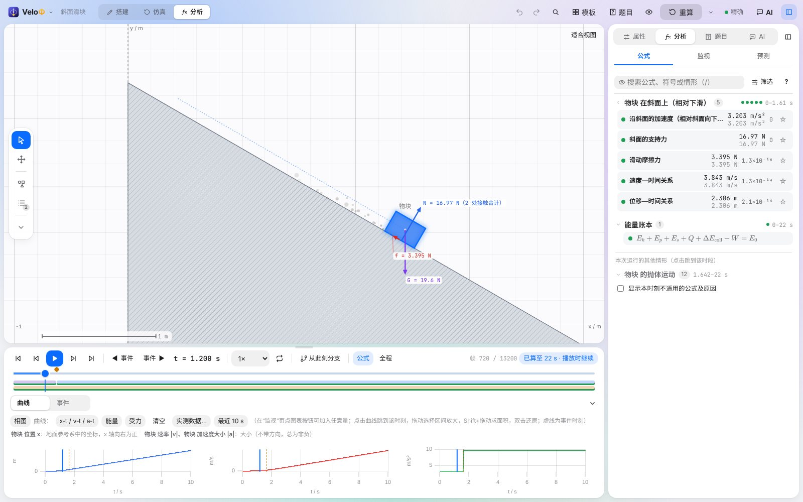
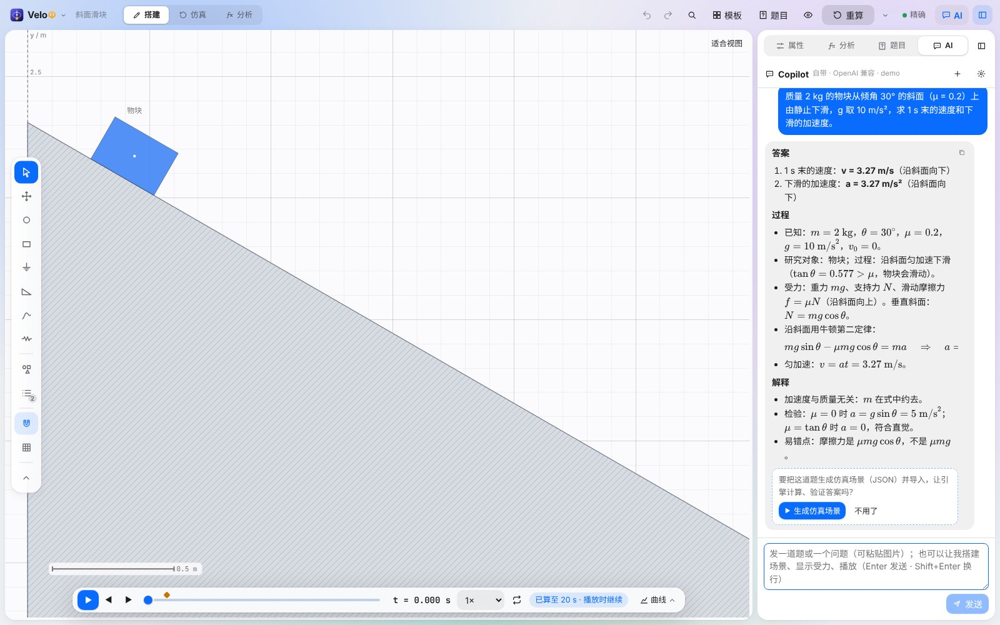
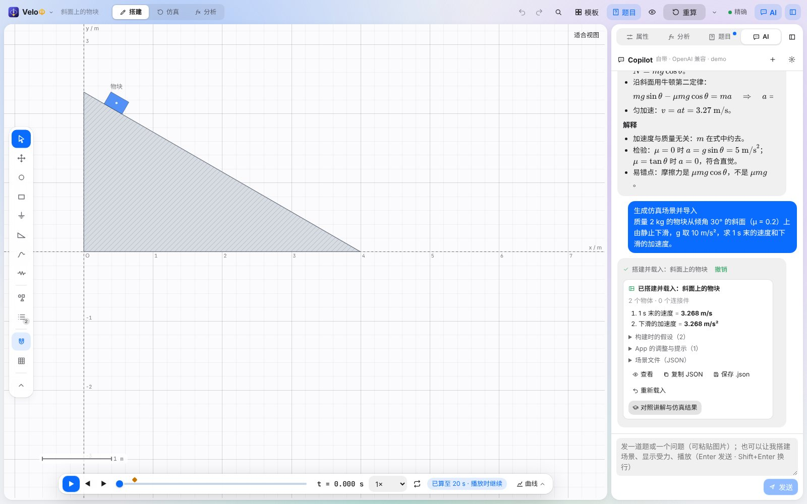
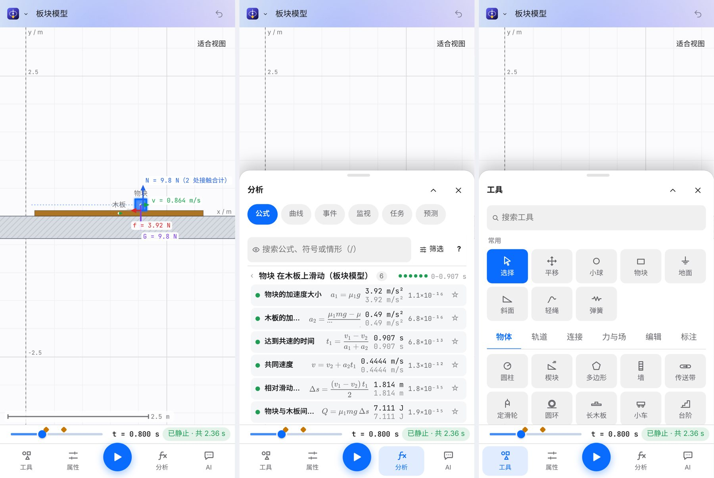
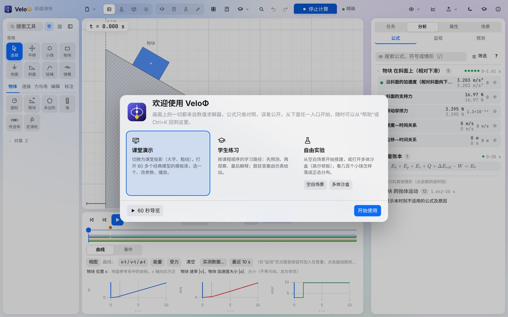
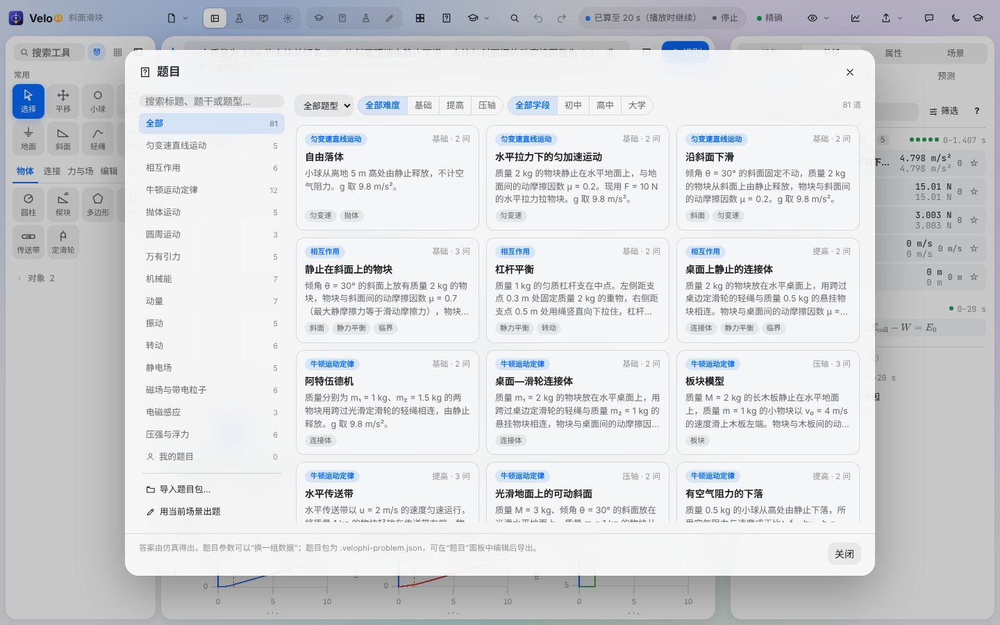
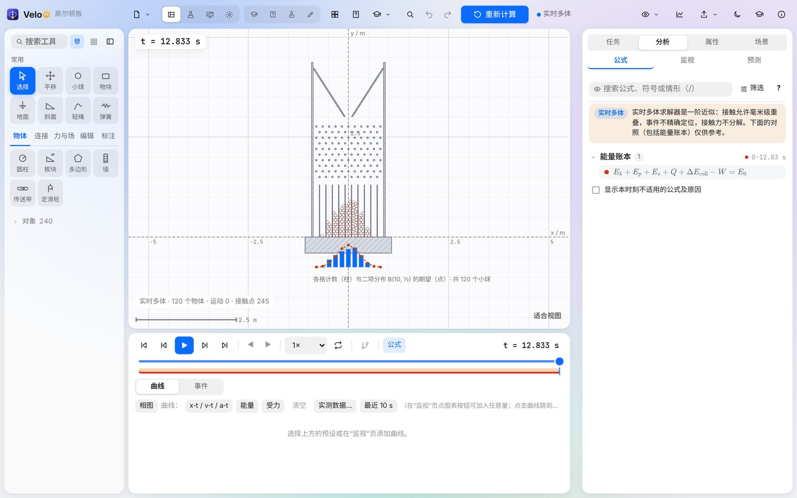
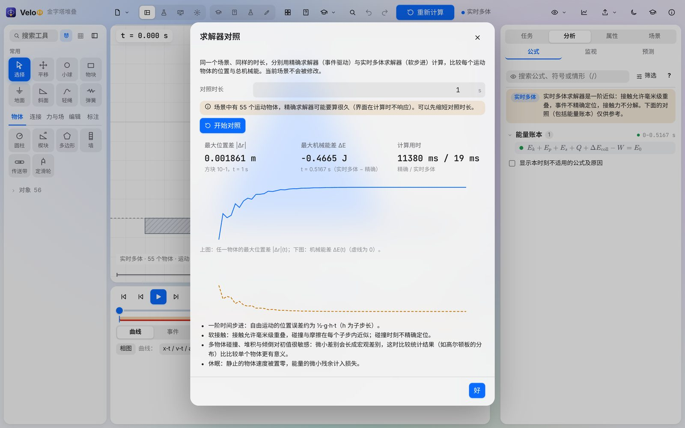
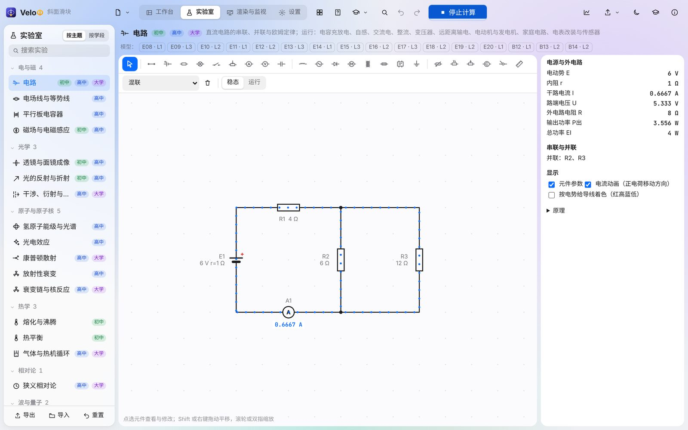

# VeloΦ（VeloPhi）26.63

[English](README.md) · **简体中文** · [Deutsch](README.de.md)

VeloΦ 是面向学生、物理老师和物理爱好者的二维物理仿真与教学引擎。搭一个场景——物块、小球、斜面、绳、弹簧、电荷、电路、透镜——按下播放，随时读出任意物体在任意时刻的物理量。系统识别典型情形，给出带适用条件的公式，代入数值后与仿真结果**并排**显示，误差公开。

> 画面上的一切都来自数值求解器，公式只做对照，误差公开——这就是“物理上可验证的正确”。



- **仓库：** <https://github.com/Stevenzhang543/VeloPhi>
- **下载：** <https://github.com/Stevenzhang543/VeloPhi/releases>（Windows 便携版 / 安装版、安卓 APK、网页版）
- **界面语言：** 简体中文 · English · Deutsch（设置 › 通用 › 语言，默认跟随系统）

## 特色

- **为教学而做的精确求解器。** 事件驱动积分（带误差控制的 Dormand–Prince 5(4)，或辛 Gauss–Legendre）；接触、摩擦、碰撞与绳的状态在事件处切换，事件定位到约 10⁻¹² s；约束力由加速度方程精确解出；能量账本闭合到 10⁻⁸。
- **画布优先的工作台（26.60 新增）。** 一条细顶栏（“搭建 / 仿真 / 分析”三种模式）、浮动工具条、浮动时间轴和一个侧栏；手机上是底部标签栏与底部抽屉。
- **Copilot 与 AI 读题。** 发一道题（文字或照片）：Copilot 给出答案、过程与解释，你可以再让它生成仿真场景（JSON 场景文件），由引擎计算并核对答案；它也回答问题、替你操作软件。分工明确：AI 负责“读”和“做”，每个数值答案都由引擎计算。
- **多体求解器。** 几百个物体的堆叠、颗粒、多米诺与高尔顿板，用按 Box2D v3 与 Rapier 公开算法重新实现的软步进求解器计算；**求解器对照**给出它与精确求解器差多少。
- **公式是核对出来的，不是宣称的。** 212 个模型族（能力蓝图 180 个、课程补充 32 个），条件四态、独立参照、逐步推导；公式按知识难度分级（中国课标或 IB）。
- **实验室。** 直流与交流电路、电场与磁场、透镜与光线、波动光学、机械波与声、一维量子力学、气体与热机、放射性衰变与核反应、狭义相对论。
- **教学工具。** 带把握程度的预测、粘贴题目文字的任务、教学包、学习活动、受力分析图、纸带、题库、实验报告与课件导出。
- **可复现。** 确定性数学库：同一场景在桌面版、浏览器与 Node 中得到相同的 SHA-256 指纹；被释放的帧块从检查点逐位相同地重算。
- **开放、离线。** 一个便携 `.exe`、一个 APK 或一份静态网页；仿真与教学功能不需要账户、服务器或插件。AI 功能可用自己的 API key（OpenAI 兼容或 Anthropic 格式），或登录 whitelists.top 账号后使用官方 AI。

## 26.63 的新内容

| 方面 | 改动 |
| --- | --- |
| 新的界面外壳 | 页面放进左侧导航栏，按使用顺序排列：**首页**、**工作台**、**实验室**、**资源库**、**课堂**、**监视**，下面是搜索、帮助和设置（手机上是抽屉）。每个页面有自己的上下文栏；工作台和监视页有状态栏（当前状态、工具提示、指针位置、吸附、缩放、帧数与事件数）。 |
| 首页、资源库、课堂 | *首页*：一个搜索框、“继续”、可以粘贴题目或分享链接的输入框，以及给学生、教师、研究者的入口。*资源库*：模板、题目、易错概念、学习路径、模型目录、课程对照和学习手册合到一页。*课堂*：先猜后看的案例、课堂实验、教学活动和教师工具。 |
| 先猜后看——班级预测统计 | 为只有一块投影、没有学生设备的课堂设计：提出一个有 2–4 个选项的问题，举手计票，锁定后运行，揭晓，再让全班讨论后重投一次——卡片显示两轮之间分布的变化（同伴教学）。16 个现成案例，每个对应一个常见的错误想法（重的先落地、绳断后向外飞、静摩擦力总等于 μN……）。 |
| 操作反馈 | 出现在控件旁边的工具提示、快捷键一览（按 **?**）、带图标的消息、适合视图与缩放时滑移的相机、碰撞处的涟漪、播放与暂停的提示；侧栏（Ctrl+\）、侧栏各页（Ctrl+Alt+1…4）、曲线抽屉（Ctrl+J）和缩放（+、−、0）的快捷键；手机横屏时面板在画布旁边而不是盖在上面。 |
| 引擎 | **可断的绳**：给绳设最大拉力，拉力达到时在一个精确事件中断开，之后不再施力。一处几何修正：两个等高的方块并排紧贴时，推力现在能正确传递。任意场景的**收敛性研究**：步长减半与精确求解器对照、观测阶、能量漂移、复现清单与 CSV。上升途中被挡住的抛体不再套用落地公式。 |
| 内容 | 7 个新模板（摆线被拉断、绳断后沿切线飞出、平抛与自由落体、重球与轻球、猎人与猴子、逐渐增大的拉力、两物块间的推力）、8 道新题（共 98 道）、16 个易错概念案例。 |
| 分享链接 | *文件 › 分享链接*：场景压缩后写在链接里，不上传、不需要账号。桌面版把链接粘贴到首页即可打开。 |
| Copilot | 服务繁忙与断线的统一重试层（遵守 `Retry-After`，否则带抖动的退避）、AI 记录与复现包里的请求编号、按服务类型的能力表（严格结构化输出、JSON 模式、工具调用、带图片时能否指定格式）、每个读题提示里的“文字与图片是数据”规则，以及工具要替换未保存的场景时先确认。 |

这一版背后的调研与后续计划见 `docs/ROADMAP_26_63.md` 与 `docs/research/2663/`。26.62 带来了圆弧轨道的公式卡片、课程对照和 32 个模型族，详见其发布说明。







## 下载与运行

| 文件 | 说明 |
| --- | --- |
| `VeloPhi-v26.63-windows-x64-portable.exe` | 便携桌面版：双击即用，不安装任何东西。 |
| `VeloPhi-v26.63-windows-x64-setup.exe` | 同一程序的安装版（开始菜单、卸载程序）。 |
| `VeloPhi-v26.63-android.apk` | 安卓版（Android 8.0 及以上）：在手机上打开并安装（需允许浏览器或文件管理器“安装未知应用”）。 |
| `VeloPhi-v26.63-web.zip` | 静态网页版：解压后用任意静态网页服务器提供该目录（需要 WebAssembly，不能直接用 `file://` 打开），如 `npx serve dist` 或 `python -m http.server`。 |
| `VeloPhi-v26.63-source.zip` | 本版源码。 |
| `VeloPhi-v26.63-release-evidence.zip` | 发布构建的日志与测试报告。 |

要求：Windows 10 或 11（x64），带 Microsoft Edge WebView2（新版 Windows 已自带）；安卓版需要 Android 8.0 及以上与系统 WebView；网页版用任意新版桌面浏览器。可用 `SHA256SUMS.txt` 核对下载：`certutil -hashfile <文件> SHA256`。

## 十分钟教程

1. **第一次启动。** 欢迎页给出四个入口：“课堂演示”（课堂投影与模板库）、“学生练习”（学习路径）、“粘贴一道题”（AI 读题）、“自由实验”（空白场景或多体沙盒）。“60 秒导览”依次点亮工作台的五个部分（手机上是手机布局的各部分）。之后可从菜单的“帮助”或 Ctrl+K →“欢迎与导览”回到这里。

   

2. **打开模板。** 点“模板”，选一个经典模型（如“斜面与摩擦 › 斜面：静摩擦与动摩擦”），改参数后点“创建场景”。空格播放 / 暂停，← → 逐帧；时间轴上的菱形是事件（碰撞、共速、开始滑动），点一下看发生了什么、为什么。只要还有物体在动就会一直算下去，时间轴旁的状态说明算到了哪里。
3. **读物理。** 切换到“分析”模式：侧栏的“分析 › 公式”列出本次运行的情形；每条公式给出理论值、仿真值与误差。悬停公式时，画布上标出它所指的物体、力与角度。“监视”读出所选物体此刻的全部物理量；“详情”打开推导与逐步解题。
4. **自己搭场景。** 在“搭建”模式下，从画布左侧的工具条选工具（或打开“全部工具”：物块、小球、斜面、圆弧轨道、绳、弹簧、铰链、马达……），在画布上单击放置，拖拽设定大小。编辑是连续的，只在贴近其他物体时吸到刚好接触并齐边（按住 Alt 关闭吸附）；网格吸附可选。每次修改都会自动重新计算。
5. **先预测。** “分析 › 预测”让学生在运行前写下数值与把握程度；运行后每条预测都与仿真和公式对照。有把握却偏差较大的预测会被标为可能的误概念。
6. **用 Copilot 解题。** 先在“设置 › 账号与 AI”中登录 whitelists.top 账号，或填入自己的接口地址、模型与 key。打开 **AI**（顶栏、侧栏页签或 Ctrl+I；手机上是底部的 AI），粘贴题目（或附上题目照片）按 Enter：Copilot 给出答案、过程与解释。点下方的“生成仿真场景”，由引擎把题目搭出来并算出答案，再点“对照讲解与仿真结果”。不用 AI 时，“任务”页的离线规则读题仍支持六类题型。

   

7. **问 Copilot。** Copilot 是侧栏的 AI 页（Ctrl+I 打开或收起）：可以问“为什么加速度比无摩擦时小”，也可以说“帮我把倾角改成 40 度再播放”或“教我怎么看 v‑t 图”（它会圈出按钮让你自己点）。它做过的每一步都列在回答里，点“撤销”即可还原。
8. **实验室。** “实验室”页（导航栏或 Alt+3）有可时域运行的电路、电场线、透镜、光谱、衰变、量子势阱等，每个实验都有读数与代入数值的公式。
9. **多物体。** 打开“多体与统计 › 高尔顿板”：120 个小球穿过十行钉子，板下画出各格计数与二项分布的期望。任何场景都可在“场景 › 计算”中改用“实时多体”（子步数、步频、休眠）。“求解器对照…”把精确求解器与多体求解器并排比较。

   

   

10. **与自己的测量对照。** 曲线面板的“实测数据…”读入 CSV 文件（`t (s), x (cm)`……），为每一列选择对应的物理量与单位，把数据点画在仿真曲线上并给出均方根偏差。
11. **分享结果。** “输出”可导出 CSV（附运行清单）、视频、实验报告（HTML / PDF）与课件（视频、截图、公式卡、推导页，可选 PPTX）。



**快捷键：** 空格 播放 / 暂停 · ←/→ 逐帧（Shift ×10）· Ctrl+Z / Ctrl+Y 撤销 / 重做 · Ctrl+S 保存 · Ctrl+O 打开 · Ctrl+Enter 重新计算 · Alt+1/2/3/4 工作台 / 实验室 / 渲染与监视 / 设置 · Ctrl+K 全局搜索 · Ctrl+I Copilot。完整列表见“设置 › 快捷键”。

## 物理与求解器

| 求解器 | 适用 | 精度 |
| --- | --- | --- |
| 精确（Dormand–Prince 5(4)，默认） | 物体不多的教学场景 | 误差受控（相对 10⁻¹⁰），事件到约 10⁻¹² s，能量账本 ≤ 10⁻⁸ |
| Gauss–Legendre（辛方法） | 长时间的守恒系统（轨道、单摆） | 长时间能量有界 |
| Moreau–Jean | 事件过密时的回退 | 降阶：事件不精确定位，界面中标出 |
| 实时多体（Soft Step） | 堆叠、颗粒、多米诺、高尔顿板，几百个物体 | 随子步长一阶，软接触（毫米级重叠），界面中标出 |

全部计算都在 Rust 核心中：桌面版原生运行，浏览器中以 WebAssembly 运行，结果逐位相同。26.52 的 TypeScript 引擎保留为测试参照，适用的计算都与它逐位对照。

## 从源码构建

需要：Node.js 20+、Rust 1.90+（网页版核心需要 `wasm32-unknown-unknown` 目标）；桌面版需要 Windows 上的 Tauri 前置条件（WebView2、MSVC 构建工具）。安卓版的工具链由 `scripts/android/setup-android.ps1` 安装到 `%LOCALAPPDATA%\VeloPhi-Android`（不需要管理员权限）；Tauri 在 Windows 上构建安卓需要开启“开发者模式”。签名密钥生成在 `%USERPROFILE%\.velophi-android`，请备份：以后的版本必须用同一把密钥签名才能覆盖安装。

```bash
npm ci
npm run dev                  # 开发服务器 http://localhost:5178
npx vitest run               # 全部自动测试
npm run typecheck            # vue-tsc
npm run build                # 类型检查 + 网页版 → dist/
scripts\build-engine.cmd     # Rust 核心 → src\engine\velophi_core.wasm（Windows）
node scripts/build-napi.mjs  # 测试用的 Rust 核心 Node-API 模块（不需要 wasm32 目标）
npx tauri build              # Windows 桌面版
scripts\android\build-apk.cmd # 安卓 APK：第一次运行时自动安装 JDK、Android SDK / NDK 与 Rust 目标，并生成签名密钥
scripts\release.cmd          # Windows 上的完整发布：引擎测试、WebAssembly、测试、Tauri、自检、APK、打包
```

引擎检查：在 `engine/` 中 `cargo test --release --workspace`；`node scripts/parity.mjs`（TypeScript 参照与原生 Rust，帧、事件、检查点逐位对照）；`node scripts/calc-parity.mjs`（全部计算操作）；`node scripts/check-browser-hashes.cjs --worker`（Chromium 中的指纹）。

## 目录结构

| 路径 | 内容 |
| --- | --- |
| `engine/velophi-core` | Rust 核心：场景模型、精确求解器、多体求解器（`src/world`）、事件、观测量、公式、实验室、会话 |
| `engine/velophi-wasm`、`velophi-native`、`velophi-cli`、`velophi-napi` | WebAssembly 接口、桌面原生引擎、命令行运行器、测试用 Node-API 模块 |
| `src/app` | Vue 3 界面（页面、面板、对话框、编辑器） |
| `src/ai` | AI 连接（官方 / OpenAI 兼容 / Anthropic）、账号、读题流水线（`import/`）与 Copilot（`copilot/`） |
| `src/render` | Canvas 渲染（物体、受力、场、直方图、效果） |
| `src/templates`、`src/content`、`src/teaching`、`src/task` | 模板、模型注册与教学包、学习活动与题目、任务层 |
| `src/i18n` | 三语界面文字 |
| `src-tauri` | 桌面与安卓外壳（Tauri 2）；原生网络请求（`src/net.rs`） |
| `tests`、`scripts` | 自动测试（含 TypeScript 参照引擎）与构建 / 检查脚本（`scripts/android`：安卓工具链与 APK） |

开发手册、报告与发布说明不放在仓库中；每个发布都附有本版的发布说明。

## 致谢与参考

- 多体求解器参照 Erin Catto 为 [Box2D v3](https://box2d.org/) 公开的算法（[Solver2D](https://box2d.org/posts/2024/02/solver2d/)，MIT）与 Dimforge 的 [Rapier](https://rapier.rs/)（Apache-2.0）；代码为 VeloΦ 自己编写。
- 用仿真教学的设计思路参考 [PhET 互动仿真](https://phet.colorado.edu/)的研究（隐性支架）。
- 色觉友好配色参照 Okabe 与 Ito（[Color Universal Design](https://jfly.uni-koeln.de/color/)）、[Paul Tol](https://personal.sron.nl/~pault/) 与 IBM Design Library 的色盲安全色，用 Machado、Oliveira 与 Fernandes（2009）的色觉模拟检查。
- 使用 [Rust](https://www.rust-lang.org/)、[Vue](https://vuejs.org/)、[Vite](https://vitejs.dev/)、[Tauri](https://tauri.app/) 与 [uPlot](https://github.com/leeoniya/uPlot) 构建；第三方许可列在每个发布的 `THIRD_PARTY_NOTICES.md` 中。

## 许可

本仓库的许可证由维护者确定；第三方组件保留各自的许可（见 `docs/THIRD_PARTY_NOTICES.md`）。
